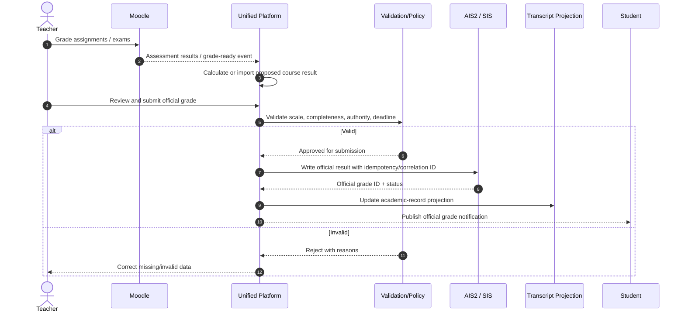
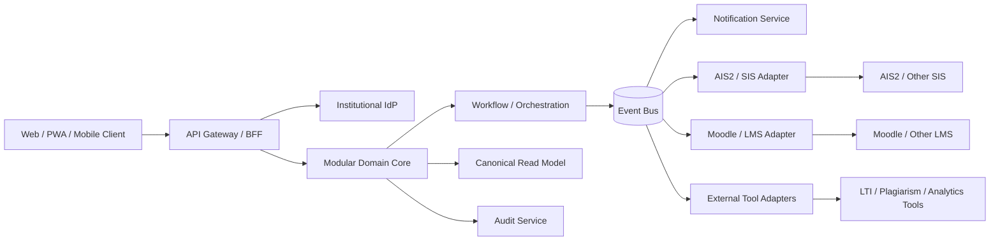
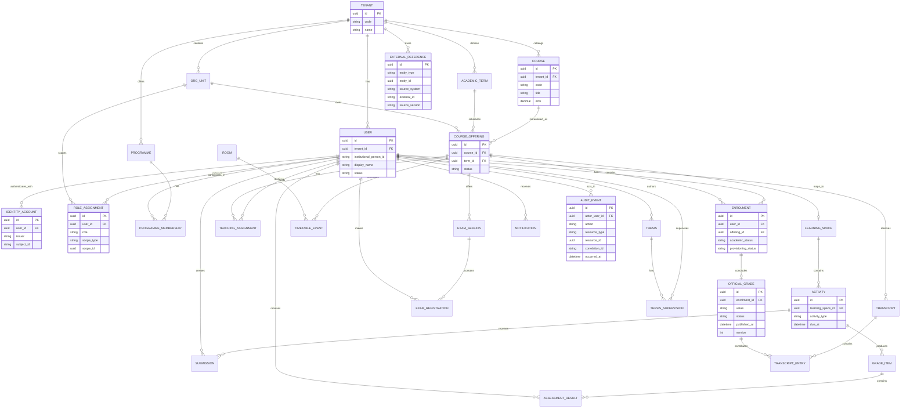

# Designing a Reusable University Web Platform That Unifies AIS2 and Moodle

## Executive summary

A bachelor thesis that simply “reimplements AIS2 and Moodle in one application” would be too large, too risky, and—most importantly—would miss the most interesting engineering problem. AIS2 and Moodle solve different parts of the university domain. AIS2 is primarily an **academic administration/student-information system**: admissions, study programmes, official study records, scheduling, course registration, examinations, theses, accommodation, administration, reporting, and integrations with Slovak national or institutional systems. Moodle is primarily a **learning management system**: course spaces, teaching resources, activities, quizzes, assignments, forums, enrolment mechanisms, gradebook, competencies, completion, messaging, analytics, and a mature plugin/API ecosystem. AIS2's own portal describes these administrative subsystems and explicitly mentions web services for integration, while current university documentation shows students using AIS2 for course and timetable registration, examinations, continuous assessment, theses, fees, and related study processes. citeturn18view0turn18view1turn18view2

The strongest thesis proposition is therefore:

> **Design and prototype a reusable university experience and integration platform that presents AIS2/SIS and Moodle/LMS functionality through one coherent domain model, workflow layer, identity model, and user interface, while preserving explicit systems of record and allowing either backend to be replaced by adapters.**

That distinction is crucial. The unified platform should initially **orchestrate** rather than indiscriminately copy or replace authoritative systems. AIS2—or another university SIS—should remain authoritative for regulated academic facts such as programme membership, official enrolment, official grades, academic status, examination registration, and transcript data. Moodle—or another LMS—should remain authoritative for instructional content, activities, submissions, formative assessment, and most course-level learning interactions. The new system becomes authoritative for cross-system workflows, integration state, notifications, user preferences, audit metadata, and optionally a canonical read model. This prevents the most dangerous integration failure: two systems independently believing they own the same grade, enrolment, or student status.

The largest feasibility risk is **AIS2 integration access**. The public AIS2 portal states that AIS2 has web services for integration with other university information-system components, but the publicly accessible material researched for this report does not provide an open endpoint catalogue comparable to Moodle's developer APIs. An open-source alternative frontend used at Comenius University, Votr, explicitly reports that AIS2 has no official API available to it and therefore resorts primarily to web scraping. That is useful evidence of the practical difficulty but is not equivalent to a statement from the AIS2 vendor that no institutional API exists. citeturn18view0turn24search1 Consequently, a rigorous thesis should define an `AIS2Connector` interface and use either **authorized institutional AIS2 web services when access is provided** or an **AIS2 simulator/mock connector** for the reproducible thesis implementation. Browser scraping should be treated as a research demonstration at most, not as the production architecture.

Moodle poses much less integration uncertainty. As of **August 8, 2026**, Moodle 5.2.1, released June 8, 2026, is the latest released 5.2 patch; Moodle 5.2.2 is scheduled for August 10, 2026. Moodle exposes external functions and web services, an event system, enrolment and gradebook APIs, OAuth support, numerous plugin types, privacy APIs, and documented database/plugin conventions. citeturn19search1turn19search3turn20search2 Moodle should therefore be integrated through supported APIs or a small purpose-built Moodle plugin where the standard web-service surface is insufficient, not through direct writes to Moodle's database.

The recommended bachelor-scale architecture is a **modular monolith with ports-and-adapters architecture**, plus asynchronous integration workers and an optional message broker. Microservices should be a deployment evolution, not the starting point. A canonical domain layer should model tenants/universities, people, organizational units, programmes, courses, offerings, enrolments, teaching assignments, assessments, grades, timetable events, theses, identities, role assignments, external references, and audit events. University-specific differences should reside in connector plugins, configuration, policies, branding, feature flags, and mappings—not in forks of the main codebase.

For interoperability, the platform should support **OIDC or SAML 2.0 for institutional SSO**, OAuth 2.0 for delegated API authorization, SCIM where available for lifecycle provisioning, LTI 1.3/LTI Advantage for learning-tool integration, and optionally OneRoster 1.2 for roster/grade exchange, Common Cartridge for portable learning content, and Caliper Analytics for standardized learning-event data. OAuth 2.0 by itself is an authorization framework, not an authentication protocol; OpenID Connect provides the identity layer on top of OAuth 2.0. citeturn22search0turn22search5turn22search2turn21search0turn21search1

A credible bachelor MVP should implement one complete vertical slice rather than every feature of both systems. The best slice is:

**SSO → unified course dashboard → authoritative enrolment → Moodle provisioning → timetable → coursework/grade display → final-grade submission → transcript projection → notifications/audit/reconciliation.**

That scope demonstrates domain modelling, two-system integration, distributed consistency, authorization, GDPR-aware design, reusable adapters, UX improvement, and objective evaluation without claiming to replace decades of SIS/LMS functionality.

The proposed thesis can be evaluated not merely by whether the software “works,” but by whether it demonstrably reduces duplicated user actions, correctly preserves authority boundaries, survives failed synchronization, can onboard a second mock university without source-code forks, meets measurable performance/security/accessibility targets, and produces zero incorrect academic-record states in controlled integration tests.

## Evidence base and system inventory

The evidence base is asymmetric. Moodle is a mature open-source platform with extensive public developer documentation. AIS2 has an official information portal and universities publish substantial operational documentation, but publicly exposed developer/API specifications are far thinner. This asymmetry should itself appear in the thesis as an architectural finding rather than being hidden.

| Area                                        | AIS2                                                                                                                                                                                                                                                                                                                | Moodle                                                                                                                                                                                                                                                | Consequence for the thesis                                                                                                          |
| ------------------------------------------- | ------------------------------------------------------------------------------------------------------------------------------------------------------------------------------------------------------------------------------------------------------------------------------------------------------------------- | ----------------------------------------------------------------------------------------------------------------------------------------------------------------------------------------------------------------------------------------------------- | ----------------------------------------------------------------------------------------------------------------------------------- |
| Product purpose                             | AIS2 describes itself as a comprehensive system for Bachelor, Master and PhD study management and university science/research support. Its documented subsystems include admissions, study programmes, scheduling, study evidence, accommodation, administration, HR, reports and configuration. citeturn18view0 | Moodle is an LMS whose core APIs cover enrolment, gradebook, activities, competencies, completion, messaging, analytics, calendar, reporting, plugins and many other learning functions. citeturn20search2turn20search1                           | Treat AIS2/SIS and Moodle/LMS as complementary bounded contexts rather than competing implementations of one database.              |
| Current public operational documentation    | AIS2's central information portal is visibly legacy material, but university-specific documentation is current: UPJŠ's student tutorial page was edited May 14, 2026, and its teacher tutorial page August 8, 2025. citeturn18view0turn18view1turn18view2                                                      | Current developer documentation is versioned, including Moodle 5.2 APIs and release documentation. citeturn20search2turn24search0                                                                                                                 | Use the central AIS2 portal for architecture/product scope and current university pages for observed workflows.                     |
| Public API documentation                    | AIS2's official portal explicitly lists “web services for integration with other components of university information system,” but the researched public portal does not expose a Moodle-like open API catalogue. citeturn18view0                                                                                | External-functions and Web Services APIs are first-class documented Moodle interfaces. citeturn20search2                                                                                                                                           | `AIS2Connector` must hide site-specific integration details. Moodle can have a concrete supported connector in the thesis.          |
| Evidence about API availability in practice | Votr, an open-source AIS2 frontend used in the Comenius University ecosystem, says it cannot use an official AIS2 API and instead emulates browser actions/scrapes responses. This is secondary rather than official AIS2 evidence. citeturn24search1                                                            | Not necessary to scrape: Moodle exposes supported service and plugin mechanisms. citeturn20search1turn20search2                                                                                                                                   | Make actual AIS2 credentials/web-service access an explicit project dependency and mock it when unavailable.                        |
| Data model documentation                    | No complete publicly documented AIS2 logical/physical schema was located in the official material reviewed. The domain can instead be reconstructed conservatively from documented subsystems and workflows. citeturn18view0turn18view1turn18view2                                                             | Moodle is modular. Plugin database tables are described through `db/install.xml`; Moodle's upgrade architecture maintains schemas through XMLDB/upgrade mechanisms. citeturn20search0                                                              | Never let either physical database schema become the platform's canonical model.                                                    |
| Extension mechanism                         | Public AIS2 material emphasizes interfaces and web services but does not publish a comparable general-purpose extension framework. citeturn18view0                                                                                                                                                               | Moodle exposes many plugin types: activity modules, enrolment/authentication plugins, web-service protocols, reports, gradebook imports/exports, repositories, plagiarism plugins, cache stores, themes, local plugins and more. citeturn20search1 | Prefer external adapters; use a Moodle plugin only where it adds an event/API capability that external web services cannot provide. |
| Events                                      | No general public AIS2 event specification was located in the reviewed material.                                                                                                                                                                                                                                    | Moodle's Events API allows events with payloads and handlers and forms the basis of logging; its Task API supports scheduled/background work. citeturn19search2turn20search2                                                                      | Moodle can feed event-driven synchronization; AIS2 may require polling/batch depending on institutional interfaces.                 |
| Security/authorization model                | AIS2 describes access supervision in terms of roles and functions, with faculty as a basic filtering dimension. citeturn18view0                                                                                                                                                                                  | Moodle's role system is based on collections of capabilities assigned within contexts, permitting roles such as student and teacher to have contextual scope. citeturn3search2turn3search18                                                       | The canonical model should represent `role + scope`, not a single global `userType`.                                                |
| Typical application architecture            | AIS2's portal describes a three-layer architecture accessed through a standard browser. citeturn18view0                                                                                                                                                                                                          | Moodle 5.2 is a PHP web application supporting PostgreSQL, MySQL, MariaDB, Aurora MySQL and Microsoft SQL Server at specified minimum versions; Moodle 5.2 requires PHP 8.3 or newer within its documented support range. citeturn24search0        | Both can be treated as external web systems; the unifier should not depend on co-location.                                          |
| Scaling patterns                            | Public AIS2 material is insufficient for prescribing internal scaling details.                                                                                                                                                                                                                                      | Moodle documentation provides cache mechanisms and supports Redis-backed patterns useful in clustered installations; Moodle 5.2 also includes locking, cache and OpenTelemetry-related APIs/features. citeturn4search9turn20search2turn24search0 | Scale the integration platform independently and make connector rate limits configurable.                                           |
| Backup/migration                            | Institution-specific and not publicly described in enough detail for a generic implementation.                                                                                                                                                                                                                      | Moodle supports site/course backup and documented migration procedures. citeturn13search2turn13search6turn13search11                                                                                                                             | The unified platform requires its own backup strategy and separate connector-aware migration plan.                                  |

**AIS2 functional evidence.** The official AIS2 portal provides the broadest product inventory. It lists admissions, programme management, scheduling, study evidence, accommodation, system and user administration, HR, administrative functions, reports/configuration, e-application/e-return, electronic signatures and integrations with external systems. citeturn18view0 Current UPJŠ student documentation adds concrete workflows: creating registration forms, registering courses, checking registration, electronic enrolment, schedule registration, examination registration, viewing continuous assessment, thesis registration/administration, questionnaires and school-fee checks. citeturn18view1 Current teacher documentation shows subject-teacher assignment, course information sheets, student lists, thesis management, assessment dates, assessment results, continuous assessment, state-exam grading, student email, subject noticeboards and teaching records. citeturn18view2

These university pages are valuable precisely because they demonstrate that AIS2 is not merely a static student database. It implements transactional workflows that have administrative consequences. A unified platform must therefore model the state machines behind course registration, examinations, theses and grading rather than merely display screens.

**Moodle functional and technical evidence.** Moodle's API catalogue includes Access, Data Manipulation, File, Logging, Analytics, Availability, Backup, Calendar, Competency, Enrolment, Events, External Functions, Message, OAuth 2, Privacy, Report Builder, Search, Task, Web Services, Activity Completion, Gradebook, Plagiarism and Question APIs. citeturn20search2 Its plugin taxonomy includes activities such as Forum, Quiz and Assignment, as well as authentication, enrolment, reporting, web-service, repository, gradebook, plagiarism and local-extension plugins. citeturn19search0turn20search1

At the data layer, Moodle's plugin upgrade documentation is an important warning against direct database coupling: each plugin describes tables through `db/install.xml`, while upgrades are applied by plugin-specific migration logic. citeturn20search0 A unified platform that reaches directly into `mdl_*` tables would bind itself to Moodle's implementation details and potentially bypass capability checks, events and upgrade semantics. The preferred order should therefore be **public service → purpose-built plugin API → read-only controlled extraction where absolutely necessary**, with database writes excluded.

As of the research date, Moodle 5.2 was released April 20, 2026 and Moodle 5.2.1 on June 8, 2026; the official release schedule lists Moodle 5.2.2 for August 10, 2026, two days after this report's August 8 research date. citeturn19search1turn19search3 That dating matters for a thesis because integration tests should pin an exact Moodle build rather than referring indefinitely to “latest Moodle.”

## Functional convergence and unified workflows

The core design problem is not deciding which system has more features. It is deciding **which domain concept each system owns**, where two concepts merely look similar, and where duplicated functionality creates semantic conflicts.

The most important example is the word **grade**. Moodle's gradebook aggregates assessed activities and supports grading workflows, while AIS2 documentation shows teachers entering assessment/continuous-assessment/state-exam results. citeturn15search30turn18view2 These should not be modelled as one writable field synchronized bidirectionally. Instead:

`Moodle assessment results → calculated/proposed course outcome → validation/approval → AIS2 official grade → transcript`

This distinction removes an entire class of race conditions.

The same principle applies to enrolment. Moodle enrolment answers **“may this person participate in this Moodle course?”** AIS2/SIS enrolment answers **“is this student academically registered for this offering?”** Moodle supports multiple enrolment mechanisms including manual and synchronized approaches, while AIS2 student workflows explicitly cover course registration. citeturn14search23turn18view1 The academic transaction should therefore happen first in the SIS domain; Moodle enrolment is a downstream provisioning consequence.

| Capability                      | AIS2 evidence / strength                                                                                                                                                                                      | Moodle evidence / strength                                                                                                             | Overlap, gap or conflict                                                               | Recommended unified behaviour                                                                                          |
| ------------------------------- | ------------------------------------------------------------------------------------------------------------------------------------------------------------------------------------------------------------- | -------------------------------------------------------------------------------------------------------------------------------------- | -------------------------------------------------------------------------------------- | ---------------------------------------------------------------------------------------------------------------------- |
| Applicant/admissions management | **Strong.** Admission procedure and electronic application are explicit AIS2 subsystems/interfaces. citeturn18view0                                                                                        | Not a core SIS-style admissions system.                                                                                                | AIS2-only domain.                                                                      | Expose admissions in unified UI later, but keep admissions system/SIS authoritative.                                   |
| Person/student record           | **Strong.** Study evidence, users, HR and administrative subsystems. citeturn18view0                                                                                                                       | Users/profiles exist primarily to support learning contexts. citeturn20search2                                                      | Similar user records with different purpose.                                           | Canonical `Person` plus external identities; never merge by email alone.                                               |
| Study programme/curriculum      | **Strong.** Study programmes are a dedicated subsystem. citeturn18view0                                                                                                                                    | Courses and competencies, but not a general registrar-grade programme-of-study system. citeturn20search2                            | Partial conceptual overlap.                                                            | SIS owns formal programme and curriculum; unified system maps programme requirements to offerings/LMS courses.         |
| Course catalogue                | AIS2 course information sheets and registration workflows expose formal course data. citeturn18view1turn18view2                                                                                           | Moodle course shells organize teaching resources and activities. citeturn19search0                                                  | **Naming conflict:** “course” may mean catalogue course, annual offering or LMS shell. | Model `Course` separately from `CourseOffering` and `LearningSpace`.                                                   |
| Academic course enrolment       | **Strong.** Registration forms and course registration are documented student tasks. citeturn18view1                                                                                                       | **Strong for LMS access.** Moodle has a dedicated Enrolment API and multiple enrolment mechanisms. citeturn20search2turn14search23 | Major overlap with different authority.                                                | SIS enrolment is authoritative; LMS participation is provisioned from it.                                              |
| Timetable/rooms                 | **Strong.** Schedule is an AIS2 subsystem and students register for schedule activities. citeturn18view0turn18view1                                                                                       | Calendar supports events but is not a full institutional room/timetable engine. citeturn20search2                                   | AIS2 stronger.                                                                         | Unified calendar overlays official timetable with LMS deadlines/events.                                                |
| Examination dates/registration  | Students register for examinations and teachers create assessment dates in AIS2. citeturn18view1turn18view2                                                                                               | Quizzes/assignments have dates but do not replace registrar examination administration. citeturn19search0                           | Semantically different concepts.                                                       | Create explicit `ExamSession`; do not map every Moodle quiz to an official exam.                                       |
| Course resources/content        | Electronic subject noticeboard exists in AIS2 deployments. citeturn18view2                                                                                                                                 | **Core strength:** course resources and pluggable learning activities. citeturn19search0turn20search1                              | Moodle much stronger.                                                                  | LMS owns instructional content; unified portal deep-links/aggregates it.                                               |
| Assignments                     | No comparable general LMS assignment workflow is evident in public AIS2 feature docs.                                                                                                                         | Dedicated Assignment activity and grading integrations. citeturn19search0turn15search0                                             | Moodle strength.                                                                       | Keep submissions in LMS/object-storage domain; platform holds references and status only unless needed.                |
| Quizzes/question bank           | Not a core documented AIS2 learning capability.                                                                                                                                                               | Moodle has Quiz, Question API and question-bank facilities. citeturn19search0turn20search2turn24search0                           | Moodle strength.                                                                       | Preserve Moodle or another LMS as assessment engine.                                                                   |
| Discussion/forums               | AIS2 student documentation includes discussion/“black box” and teacher noticeboards, but not Moodle-equivalent course communities. citeturn18view1turn18view2                                             | Moodle Forum is a core activity with discussion functionality. citeturn19search0                                                    | Overlap.                                                                               | Pick one student-facing discussion channel per course; do not duplicate messages.                                      |
| Continuous assessment           | Students can view and teachers can enter continuous assessment in AIS2. citeturn18view1turn18view2                                                                                                        | Moodle gradebook aggregates activity grades. citeturn15search30turn20search2                                                       | **High-risk overlap.**                                                                 | Moodle owns assessment evidence; AIS2 receives only institutionally required summaries/results.                        |
| Final course result             | AIS2 teachers register assessment results. citeturn18view2                                                                                                                                                 | Moodle gradebook can calculate course grades. citeturn15search30                                                                    | **Critical conflict.**                                                                 | Introduce `CalculatedGrade`, `ProposedOfficialGrade` and immutable/versioned `OfficialGrade` as distinct objects.      |
| State examinations              | Explicit AIS2 teacher workflow. citeturn18view2                                                                                                                                                            | Not a registrar-grade state-examination system.                                                                                        | AIS2 strength.                                                                         | SIS domain only; LMS may supply preparation content.                                                                   |
| Thesis lifecycle                | Students register/administer theses and teachers register, accept and evaluate them; AIS2 also documents an interface to Slovakia's central thesis register, CRZP. citeturn18view0turn18view1turn18view2 | Moodle can store files/assignments but has no equivalent general statutory thesis workflow.                                            | AIS2 strength.                                                                         | Separate `Thesis` aggregate with supervisor, assignment, version, review and external-registry status.                 |
| Competencies/completion         | Not prominent in reviewed AIS2 operational material.                                                                                                                                                          | Moodle has Competency, Activity Completion and related APIs. citeturn20search2                                                      | Moodle strength.                                                                       | Reuse LMS learning-progress model; optionally aggregate into unified progress dashboard.                               |
| Fees                            | AIS2 student tutorials include school-fee charge checks. citeturn18view1                                                                                                                                   | Moodle has a Payment API but is not a general university finance/student-account system. citeturn20search2                          | Different domains.                                                                     | Treat university finance as an external bounded context; show status, avoid duplicating accounting.                    |
| Accommodation                   | Explicit AIS2 subsystem. citeturn18view0                                                                                                                                                                   | Not core LMS functionality.                                                                                                            | AIS2-only/general university domain.                                                   | Optional connector/module, not MVP.                                                                                    |
| Messaging/notifications         | Teacher email and subject noticeboard workflows are documented. citeturn18view2                                                                                                                            | Moodle exposes Message/Communication APIs and notification mechanisms. citeturn20search2turn15search2                              | Strong overlap, high UX duplication.                                                   | Unified notification inbox with deduplication, preferences, severity and deep links.                                   |
| Surveys/feedback                | AIS2 student questionnaires are documented. citeturn18view1                                                                                                                                                | Moodle provides feedback/activity mechanisms and reporting.                                                                            | Overlap.                                                                               | Institution-wide evaluation can remain SIS/quality-system-owned; course formative surveys can remain LMS-owned.        |
| Analytics/reporting             | AIS2 includes reports/configuration. citeturn18view0                                                                                                                                                       | Moodle has Analytics and Report Builder APIs plus logs/events. citeturn20search2                                                    | Data is fragmented.                                                                    | Build governed cross-system analytics read models; never let analytics become the source of academic truth.            |
| Audit/logging                   | Administrative system and role controls are present, but public documentation is not detailed enough to define the audit contract. citeturn18view0                                                         | Moodle Events underpin logging and supports reporting/log stores. citeturn19search2turn20search1                                   | Unified cross-system audit is missing.                                                 | Introduce a platform audit stream recording actor, scope, intent, result, correlation ID and source-system references. |
| Accessibility/mobile            | AIS2 is browser-based; reviewed public product material reflects an older UI generation. citeturn18view0                                                                                                   | Moodle has a current mobile-app ecosystem; Moodle App 5.2.1 was released July 10, 2026. citeturn19search5                           | Opportunity for UX improvement.                                                        | New portal should be mobile-first/PWA-capable and WCAG 2.2 AA-oriented.                                                |

The recommended unified feature set is therefore not simply the union of every checkbox. It is a **layered feature model**:

**Authoritative academic core:** identity linkage, programmes, curricula, catalogue, offerings, official enrolment, timetable, examination sessions, official grades, academic standing, thesis workflows and transcript data.

**Learning core:** learning spaces, resources, activities, submissions, quizzes, discussions, formative assessment, gradebook, competencies and completion.

**Unified experience layer:** dashboard, global search, calendar, tasks/to-do list, notifications, course overview, enrolment status, grade overview, transcript view, user preferences and links into source-specific specialist screens.

**Cross-system orchestration:** enrolment provisioning, course-shell provisioning, teacher provisioning, final-grade publication, timetable propagation, deadline aggregation, lifecycle deprovisioning, reconciliation and audit.

**Administrative operations:** integration health, failed-message queue, role mappings, tenant configuration, source-system mappings, feature flags, policy configuration, data-quality dashboards and manual exception resolution.

The role model should likewise be scoped rather than hard-coded.

| User                                | AIS2-oriented responsibilities                                                                                                                            | Moodle-oriented responsibilities                                                                                      | Unified role design                                                                                                                                   |
| ----------------------------------- | --------------------------------------------------------------------------------------------------------------------------------------------------------- | --------------------------------------------------------------------------------------------------------------------- | ----------------------------------------------------------------------------------------------------------------------------------------------------- |
| **Student**                         | Course registration, schedule/exam registration, study results, thesis, fees, questionnaires. citeturn18view1                                          | Consume content, submit work, take assessments, communicate, inspect learning grades/progress.                        | `Student` scoped to one or more programme/enrolment contexts; permissions derived from active academic status.                                        |
| **Teacher**                         | Course information, teaching assignments, assessment dates/results, continuous assessment, thesis supervision/evaluation, state exams. citeturn18view2 | Course authoring, assignments/quizzes, grading, forums, learning analytics.                                           | `Instructor` scoped to `CourseOffering`; separate capabilities for content authoring and official-grade submission.                                   |
| **Registrar / study office**        | Operational responsibility inferred from AIS2's study-evidence and administrative domains and university workflows. citeturn18view0                    | Usually limited Moodle responsibility.                                                                                | High-trust academic-record capabilities: override enrolment, validate programme status, correct official grade, issue transcript, resolve exceptions. |
| **Academic/business administrator** | Programme setup, schedules, reports, users, organizational configuration and related subsystems. citeturn18view0                                       | Course/category management and delegated administration.                                                              | Domain-admin roles separated by faculty/department/tenant rather than one all-powerful administrator.                                                 |
| **IT/system administrator**         | Technical integration, user/system administration. citeturn18view0                                                                                     | Site configuration, authentication, plugins, web services and platform operations. citeturn20search1turn20search2 | Technical administration must not automatically imply permission to alter academic outcomes.                                                          |

That last separation is important: **system administrator, registrar and teacher should not be synonymous superusers**. A developer may need to troubleshoot integration messages without having business authority to change a student's grade.

The recommended enrolment workflow is:

```mermaid
sequenceDiagram
    autonumber
    actor Student
    participant UI as Unified Portal
    participant WF as Workflow Service
    participant SIS as AIS2 / SIS Connector
    participant DB as Canonical Read Model
    participant LMS as Moodle Connector
    participant N as Notification Service

    Student->>UI: Select course offering
    UI->>WF: Request enrolment
    WF->>SIS: Check eligibility, capacity, prerequisites
    SIS-->>WF: Eligible + current version

    WF->>SIS: Create authoritative enrolment
    SIS-->>WF: Enrolment confirmed + external ID

    WF->>DB: Record CONFIRMED academic enrolment
    WF->>LMS: Provision Moodle participation

    alt Moodle succeeds
        LMS-->>WF: LMS enrolment ID
        WF->>DB: Mark learning space READY
        WF->>N: Enrolment completed
        N-->>Student: Confirmation
    else Moodle unavailable
        LMS-->>WF: Timeout / error
        WF->>DB: Mark LMS provisioning PENDING
        WF->>WF: Schedule idempotent retry
        WF->>N: Academic enrolment valid; LMS pending
        N-->>Student: Provisioning delayed
    end
```

A Moodle outage must **not roll back an already accepted academic enrolment** unless institutional business rules explicitly demand atomicity across both systems. The correct state is usually “academically enrolled, Moodle provisioning pending,” followed by retry/reconciliation.

The final-grade workflow should be deliberately asymmetric:



For **timetables**, the ideal student journey is: open one calendar → see official lectures/seminars/examinations from the SIS → overlay Moodle assignment deadlines and learning events → immediately see clashes → filter by course → export/subscribe to a calendar feed. AIS2 remains authoritative for official teaching slots; Moodle remains authoritative for learning deadlines. The unified calendar performs composition rather than inventing a third schedule.

For **transcripts**, the platform should never calculate the legally meaningful transcript from Moodle's gradebook. A transcript request should read versioned official academic outcomes from the SIS/canonical academic record, apply institution-specific transcript rules, produce a preview, and—where the university permits—generate a digitally signed/verifiable document. Access and issuance should be audited. Moodle grades can enrich the student-facing progress page but are not a substitute for the official record.

## Integration architecture and data model

The main architectural rule should be **integration through contracts rather than database coupling**.

A reusable design can be expressed as:



The connector contracts, not the product names, make this reusable. For example:

```text
StudentInformationSystem
    getPerson()
    getProgrammeMemberships()
    listCourseOfferings()
    checkEnrolmentEligibility()
    createEnrolment()
    cancelEnrolment()
    getTimetable()
    getExamSessions()
    registerForExam()
    getOfficialResults()
    submitOfficialGrade()
    getTranscriptData()

LearningManagementSystem
    ensureUser()
    ensureCourseSpace()
    enrolUser()
    unenrolUser()
    listActivities()
    getAssessmentResults()
    createCalendarEvent()
    getCompletion()
```

`AIS2Connector` and `MoodleConnector` become concrete implementations. Another university could provide `PeopleSoftConnector`, `BannerConnector`, `SAPStudentLifecycleConnector`, `CanvasConnector`, `BlackboardConnector`, etc., without changing the core workflow semantics.

**Integration approach comparison**

| Approach                                           | Best use                                                                             | Advantages                                                                                                                                                                | Limitations / risks                                                                                                                                                                      | Recommendation                                                                                       |
| -------------------------------------------------- | ------------------------------------------------------------------------------------ | ------------------------------------------------------------------------------------------------------------------------------------------------------------------------- | ---------------------------------------------------------------------------------------------------------------------------------------------------------------------------------------- | ---------------------------------------------------------------------------------------------------- |
| **Direct supported API/web-service integration**   | CRUD/query against SIS/LMS business capabilities                                     | Least extra infrastructure; preserves source-system validation when API is well designed                                                                                  | Vendor-specific mappings; version changes; AIS2 public API specification is the key uncertainty                                                                                          | **Primary approach** wherever approved services exist.                                               |
| **Purpose-built Moodle plugin**                    | Missing web-service endpoint, richer event publication, custom Moodle-side behaviour | Fits Moodle's documented extension system and Events/Web Services APIs. citeturn20search1turn20search2                                                                | Must be upgraded/tested with Moodle releases; increases deployment dependency                                                                                                            | Use narrowly, not as the whole unified application.                                                  |
| **Integration middleware / anti-corruption layer** | Translating SIS/LMS models into a canonical university model                         | Isolates vendor semantics; enables retries, observability and multi-university reuse                                                                                      | Additional code and operational component                                                                                                                                                | **Central architectural recommendation.**                                                            |
| **LTI 1.3 / LTI Advantage**                        | Launching external learning tools from an LMS/platform with course/user context      | Standardized integration; LTI Advantage includes Assignment and Grade Services, Names and Role Provisioning Services and Deep Linking. citeturn21search0turn21search4 | Does not replace full SIS synchronization, admissions, transcripts or institutional timetable APIs                                                                                       | Use for learning-tool ecosystem, not as the SIS integration layer.                                   |
| **OneRoster 1.2**                                  | Standard roster/resource/gradebook exchange between education systems                | Defines REST and CSV exchange and separate Rostering, Resources and Gradebook services. citeturn21search1turn21search25                                               | Ecosystem suitability must be checked for European higher education; it cannot represent every university-specific process                                                               | Offer as optional standard adapter/profile.                                                          |
| **Common Cartridge**                               | Moving reusable learning content                                                     | Standardized packaging/import/export of digital learning resources. citeturn21search2                                                                                  | Not a transactional student-record protocol                                                                                                                                              | Optional course-content portability capability.                                                      |
| **Caliper Analytics**                              | Normalized learning-event collection                                                 | Provides standardized learning-activity data for analytics. citeturn21search3                                                                                          | Analytics data raises governance/privacy concerns and is not authoritative academic data                                                                                                 | Strong option for later analytics layer.                                                             |
| **SAML 2.0**                                       | Enterprise/university federated SSO                                                  | Established framework for authentication assertions/federation. citeturn22search2turn22search6                                                                        | XML/metadata complexity; often heavier for new applications                                                                                                                              | Support where institutional federation already uses SAML.                                            |
| **OAuth 2.0**                                      | Delegated API authorization                                                          | Standard authorization framework. citeturn22search5                                                                                                                    | **OAuth alone is not user authentication.**                                                                                                                                              | Use for API authorization, with modern security guidance from RFC 9700. citeturn22search1         |
| **OpenID Connect**                                 | Modern web/mobile SSO                                                                | Adds an interoperable identity layer over OAuth 2.0. citeturn22search0                                                                                                 | Requires compatible IdP                                                                                                                                                                  | Preferred authentication protocol for a greenfield portal when institution supports it.              |
| **SCIM**                                           | Account/group provisioning and lifecycle                                             | Standardized HTTP-based cross-domain identity-management protocol and schema. citeturn22search3turn22search7                                                          | Universities may not expose it                                                                                                                                                           | Optional provisioning adapter; do not require it for MVP.                                            |
| **Batch CSV/file exchange**                        | Legacy systems, nightly roster/catalog exchange                                      | Easy to audit/replay; compatible with systems lacking modern APIs; OneRoster itself supports CSV. citeturn21search1                                                    | Stale data; awkward error resolution; poor user feedback                                                                                                                                 | Valid fallback for low-volatility data.                                                              |
| **Browser automation/scraping**                    | Prototype where no authorized machine interface exists                               | Demonstrates feasibility                                                                                                                                                  | Fragile UI coupling, credentials/session risk, difficult authorization/audit and versioning; Votr illustrates why this workaround may become necessary around AIS2. citeturn24search1 | **Do not make it the production architecture.** Use only for research with institutional permission. |

A particularly useful standards distinction for the thesis is:

- **LTI** integrates a learning tool into a learning platform and handles contextual launch and related services.
- **OneRoster** exchanges roster/resources/gradebook information.
- **Common Cartridge** moves learning content.
- **Caliper** standardizes learning telemetry.
- **OIDC/SAML** address authentication/federation.
- **OAuth** addresses authorization.
- **SCIM** addresses identity provisioning.

No single standard solves “AIS2 + Moodle integration.”

**Synchronization strategy.** The recommended model is hybrid rather than ideologically “real time.”

High-value transactional changes—new enrolment, enrolment cancellation, teacher assignment, final-grade publication—should generate events or immediate workflow actions. Large catalogues, historical data, degree requirements, or data from systems without event APIs can be refreshed periodically. A nightly reconciliation should run even when event-driven synchronization exists, because events can be lost, endpoints can fail and administrators can modify source systems outside the unified platform.

Each synchronized record should carry at least:

```text
internal_id
tenant_id
source_system
external_id
source_version / updated_at
last_synchronized_at
synchronization_status
correlation_id
```

Mappings must never depend solely on names or email addresses. A student changing email, a course being renamed, or two universities using the same course code must not create duplicate identities.

A **field-ownership policy** should be explicit:

| Data                           | Canonical owner                                 | Replication direction                 |
| ------------------------------ | ----------------------------------------------- | ------------------------------------- |
| Legal/official person identity | University identity/SIS                         | IdP/SIS → platform → LMS as required  |
| Programme membership           | SIS/AIS2                                        | SIS → platform                        |
| Course catalogue               | SIS/AIS2                                        | SIS → platform → LMS metadata         |
| Course offering                | SIS/AIS2                                        | SIS → platform → LMS shell            |
| Official academic enrolment    | SIS/AIS2                                        | SIS → platform → LMS participation    |
| Teaching assignment            | SIS/HR according to institution                 | authoritative source → platform → LMS |
| Learning resources             | Moodle/LMS                                      | LMS → platform projection             |
| Submission                     | Moodle/LMS                                      | LMS → platform reference/analytics    |
| Individual assessment result   | Moodle/LMS unless institution decides otherwise | LMS → platform                        |
| Proposed final grade           | Unified workflow                                | computed/entered → approval           |
| Official final grade           | SIS/AIS2                                        | workflow → SIS → read model           |
| Official timetable             | AIS2/timetabling system                         | source → platform                     |
| LMS deadlines                  | Moodle                                          | Moodle → platform calendar            |
| Notification preference        | Unified platform                                | platform-owned                        |
| Cross-system audit/correlation | Unified platform                                | platform-owned                        |
| Transcript facts               | SIS/official record                             | SIS → platform                        |

For write workflows, use **idempotency**. Repeating `createLmsEnrolment(student=123, offering=456)` after a timeout should not create a second enrolment. The platform should store an operation key and external result/reference.

Retries should use bounded exponential backoff with jitter; non-transient validation failures should not be retried indefinitely. After the retry budget is exhausted, the operation belongs in a **dead-letter/exception queue** visible to IT administrators. The student-facing state should remain meaningful—`CONFIRMED`, `PROVISIONING`, `ACTION_REQUIRED`—rather than exposing HTTP 500 errors.

For operations involving the platform's own database and an event broker, a **transactional outbox** is a strong design choice: write the business state and an outbound-event record in one local database transaction, then publish asynchronously. For multi-system workflows, use explicit saga/compensation semantics rather than pretending a distributed ACID transaction exists. For example, cancelling an academic enrolment can request Moodle deprovisioning; failure to remove Moodle access becomes a security exception that retries and alerts administrators.

Conflicts need domain-specific resolution. “Last write wins” may be acceptable for a noncritical display preference but is unacceptable for official grades. A final-grade mismatch should produce a human-review case showing both values, timestamps, source systems, actors and change history.

The following ER model represents a practical canonical domain. It intentionally separates academic concepts from LMS-specific representations.



A full implementation would add curriculum requirements, prerequisite graphs, grading schemes, attendance, document metadata, thesis reviews, programme versions and richer organizational structures. For the bachelor thesis, however, keeping the core model understandable is more valuable than reproducing hundreds of vendor tables.

## Security, privacy, and nonfunctional architecture

The unified platform increases convenience but also increases security impact: one authenticated session may now expose enrolments, grades, timetable, submissions, programme information and administrative actions that previously lived in separate applications. This makes centralization of **authorization, auditability and identity lifecycle** more important, not less.

Under GDPR, university personal-data processing needs explicit purposes and lawful bases and must observe principles including purpose limitation, data minimization, accuracy, storage limitation, integrity/confidentiality and accountability. The Regulation also establishes requirements relevant to privacy by design/default, processors, security of processing, breach handling and data-protection impact assessments. citeturn23search0turn23search27 The thesis should therefore treat GDPR as a set of architecture constraints rather than an “accept privacy policy” checkbox.

For each category of data, a production deployment should record:

| Question                        | Example                                                                                                                          |
| ------------------------------- | -------------------------------------------------------------------------------------------------------------------------------- |
| Why is this data needed?        | Academic enrolment is needed to provide study administration and provision LMS access.                                           |
| Which system is authoritative?  | SIS/AIS2.                                                                                                                        |
| Which parties receive it?       | Unified platform and Moodle, but only fields necessary for Moodle participation.                                                 |
| Retention rule                  | Defined by institutional/legal records policy, not hard-coded by the software developer.                                         |
| Can the user amend it directly? | Contact/preference data perhaps yes; official grade normally through controlled correction workflow.                             |
| Can it be deleted?              | Depends on legal/academic-record obligations; GDPR erasure is not an unconditional requirement to erase every university record. |
| Who may view it?                | User plus explicitly authorized teaching/administrative staff.                                                                   |
| What audit is required?         | Reads of highly sensitive administrative records where appropriate, and all consequential writes.                                |

The platform should not indiscriminately ingest every field available from AIS2 and Moodle “because it might be useful.” For example, an LMS connector may need institutional ID, name, email, course and role; it generally does not need unrelated financial or accommodation data. This is data minimization applied structurally. citeturn23search0

A production deployment should involve the university's DPO/legal function in deciding Article 6 lawful bases, processor/controller relationships, retention, international transfers and whether a DPIA is required. Core university administration should not be designed on the assumption that freely withdrawable consent is the only lawful basis; the applicable lawful basis depends on the institution and processing purpose under GDPR and national law. citeturn23search0

Moodle itself provides a Privacy API through which plugins can describe stored personal data and support per-user discovery/export/deletion responsibilities, explicitly oriented toward GDPR compliance. citeturn19search2turn16search19 Any custom Moodle plugin created by the thesis should use that mechanism rather than becoming invisible to Moodle's privacy tooling.

**Authentication.** The unified portal should delegate primary authentication to the university identity provider. For new integrations, OIDC is a strong default; for institutions already federated through SAML 2.0, SAML should be supported. OIDC is explicitly an identity layer over OAuth 2.0, whereas OAuth 2.0 itself defines authorization. citeturn22search0turn22search5turn22search2 Service-to-service access should use narrowly scoped tokens/credentials rather than user passwords. OAuth deployments should follow the current security best-practice guidance in RFC 9700. citeturn22search1

**Authorization.** Use a combination of RBAC and contextual attributes. A permission decision might be:

```text
Can user U submit an official grade for student S?

role(U) contains INSTRUCTOR
AND teachingAssignment(U, offering) is active
AND enrolment(S, offering) is active
AND gradeSubmissionWindow(offering) is open
AND tenant(U) = tenant(S)
AND requiredStepUpAuthentication(U) is satisfied
```

That is substantially safer than `if user.role == "teacher"`.

Permissions should be scoped at tenant, faculty/organizational unit, programme, course offering and sometimes individual record level. Moodle's contextual/capability-oriented role model provides precedent for treating authorization as capabilities in context rather than global labels. citeturn3search2turn3search18

**Sensitive operations** should require stronger controls. Grade correction, transcript issuance, mass export, role escalation and connector-secret management deserve step-up authentication or at least stronger session assurance, reason capture and audit. Authentication administrators should not automatically receive academic-record modification privileges.

**Auditability.** Store structured events such as:

```json
{
  "actor": "user:...",
  "action": "official_grade.submit",
  "target": "enrolment:...",
  "tenant": "university:...",
  "oldValueHash": "...",
  "newValue": "A",
  "businessReason": "Final course result",
  "source": "unified-platform",
  "destination": "ais2",
  "correlationId": "...",
  "occurredAt": "...",
  "outcome": "SUCCESS"
}
```

Logs should be tamper-resistant, access-controlled and subject to retention/minimization policies; they should not casually contain passwords, session tokens or unnecessary personal data. Moodle's event model already forms the basis of its logging, and OWASP ASVS provides a suitable verification framework for the new web application. citeturn19search2turn23search1turn23search7

Security testing should target **OWASP ASVS 5.0** requirements appropriate to the risk profile rather than relying only on a penetration test at the end. OWASP released ASVS 5.0.0 in May 2025 and describes ASVS as a basis for testing web-application technical security controls and secure-development requirements. citeturn23search1turn23search7 A later native mobile application should similarly use OWASP MASVS as a verification reference. citeturn23search10

Accessibility should be a first-class nonfunctional requirement. WCAG 2.2 is a W3C Recommendation and defines testable accessibility success criteria across perceivable, operable, understandable and robust principles. citeturn16search2turn16search14 For public-sector universities in the EU, the Web Accessibility Directive is additionally relevant to public-sector websites and mobile applications; applicability to a particular institution/application should be verified institutionally. citeturn23search2turn23search5

The following are **proposed project acceptance targets**, not claims about existing AIS2 or Moodle installations:

| NFR                         | Bachelor prototype target                                                                                               | Production-oriented direction                                                                                         |
| --------------------------- | ----------------------------------------------------------------------------------------------------------------------- | --------------------------------------------------------------------------------------------------------------------- |
| Availability                | Demonstrate graceful connector failure and recovery                                                                     | ≥99.9% baseline, stronger during registration/exam windows if institution requires it                                 |
| Read latency                | p95 <300 ms for cached/canonical dashboard API                                                                          | Establish SLO by workload/region                                                                                      |
| Orchestrated user operation | Portal acknowledges action within ~1 s where external synchronous call permits; otherwise immediately show `PROCESSING` | Async workflows with explicit state instead of long browser blocking                                                  |
| Data correctness            | **Zero silent incorrect official enrolment/grade states** in evaluation dataset                                         | Reconciliation + exception handling; correctness takes priority over latency                                          |
| Retry behaviour             | Automated recovery from controlled transient connector failures                                                         | Configurable retry/backoff and dead-letter processing                                                                 |
| Scalability                 | Load-test at thesis-defined concurrency, e.g. hundreds of active simulated sessions                                     | Benchmark against university's peak registration window before deployment                                             |
| RPO                         | Demonstrate automated DB backups and restore                                                                            | Institution-defined; ≤15 min is a reasonable candidate for critical integration state where infrastructure permits    |
| RTO                         | Demonstrate documented restore procedure                                                                                | Institution-defined; several hours may be acceptable for some functions but registration windows may require far less |
| Accessibility               | WCAG 2.2 AA-oriented automated + manual checks; zero known critical keyboard/focus blockers                             | Formal accessibility audit where required                                                                             |
| Security                    | Selected ASVS 5.0 requirements automated/manual verified                                                                | Continuous security verification, SAST/dependency scanning/pen testing                                                |
| Observability               | Correlation ID across every cross-system workflow                                                                       | Metrics, logs, traces, dashboards and alerting                                                                        |
| Localization                | At least English + one Slovak localization in prototype                                                                 | Tenant-configurable languages/time zones/academic formats                                                             |
| Browser/mobile              | Responsive modern browser UI                                                                                            | PWA/native clients if justified                                                                                       |
| Maintainability             | ≥80% coverage for domain/integration-critical modules is a possible target, supplemented by scenario tests              | Coverage treated as one signal rather than a quality proxy                                                            |
| Portability                 | Deploy second mock university without forking core source                                                               | New tenant primarily configuration + connector work                                                                   |

Performance testing needs to include the **registration burst**, not just average traffic. The interesting scenario is hundreds or thousands of students simultaneously querying course capacity and attempting registrations while Moodle/SIS connectors respond at different speeds. The platform should absorb noncritical downstream work asynchronously rather than turning an LMS slowdown into an SIS-registration outage.

## Extensibility, deployment, and operations

For this thesis, a **modular monolith** is a better starting architecture than microservices.

| Architecture                                         | Benefits                                                                                                   | Costs                                                                                                                 | Verdict                          |
| ---------------------------------------------------- | ---------------------------------------------------------------------------------------------------------- | --------------------------------------------------------------------------------------------------------------------- | -------------------------------- |
| Traditional monolith with little internal modularity | Fast initial development                                                                                   | Vendor-specific integration and academic logic become tangled; difficult evolution                                    | Avoid                            |
| **Modular monolith + ports/adapters**                | One deployment and transaction boundary; easier debugging; clear bounded contexts; modules can later split | Requires discipline to prevent cross-module coupling                                                                  | **Best bachelor-project choice** |
| Microservices from the start                         | Independent deployment/scaling; organizational isolation                                                   | Distributed tracing, contracts, service discovery, deployment, network failures, data consistency and test complexity | Excessive for one-student MVP    |
| Modular core + separate connector workers            | Keeps domain code simple while isolating unreliable/slow integrations                                      | Slightly more operational complexity                                                                                  | Excellent intermediate design    |

Suggested internal modules are:

```text
identity
organization
academic-catalog
programmes
enrolment
learning
assessment
official-results
timetable
transcript
thesis
notifications
audit
integration
tenant-configuration
reporting
```

They should interact through application/domain interfaces rather than importing one another's database repositories arbitrarily.

**The extension system should have several distinct plugin interfaces.**

`SISConnector` adapts AIS2 or alternative SIS products. `LMSConnector` adapts Moodle or alternatives. `IdentityConnector` handles IdP/user provisioning. `NotificationProvider` handles email, push, SMS or institutional messaging. `PolicyProvider` allows different universities to implement prerequisites, grading windows or enrolment policies. `DocumentProvider` handles transcript/thesis document storage/signature. `AnalyticsSink` exports governed telemetry. `Theme/Branding` handles university presentation without business-logic forks.

Each extension should declare metadata such as:

```yaml
id: sk.example.ais2
type: sis
capabilities:
  - catalog.read
  - enrolment.read
  - enrolment.write
  - timetable.read
  - grades.read
  - grades.write
configurationSchema: ais2-connector.schema.json
healthCheck: true
```

Capability discovery matters because one university may expose AIS2 enrolment writes while another grants only read access. The core workflow can then adapt instead of assuming every connector provides everything.

Moodle demonstrates the value of a well-defined plugin taxonomy: it provides separate extension points for authentication, enrolment, activities, reports, web-service protocols, repositories, gradebook functionality, plagiarism, caching, themes and local customizations. citeturn20search1 The new platform does not need to reproduce dozens of Moodle plugin categories, but it should copy the architectural lesson: **extensions should attach at explicit interfaces rather than patch the core**.

A public platform API should use versioned REST/JSON for broad accessibility, with OpenAPI documentation generated from code/contracts. Events should be versioned separately. For example:

```text
GET  /api/v1/me
GET  /api/v1/course-offerings
POST /api/v1/course-offerings/{id}/enrolments
GET  /api/v1/me/timetable
GET  /api/v1/me/results
POST /api/v1/course-offerings/{id}/official-grades:submit
GET  /api/v1/me/transcript
```

External consumers should never receive direct database credentials. Webhooks should be signed and retried; API clients should have granular OAuth scopes such as `enrolment.read`, `enrolment.write` or `grades.submit`.

**Multi-university reuse** should be configuration-driven:

```text
Tenant
  branding
  locale/timezone
  academic calendar rules
  grading schemes
  identity provider configuration
  SIS connector + mapping
  LMS connector + mapping
  role mapping
  feature flags
  notification channels
  retention configuration
  course/enrolment policy plugins
```

For the prototype, a shared PostgreSQL database containing a mandatory `tenant_id` on tenant-owned records is simplest. Production deployments needing stronger contractual or regulatory isolation could move to separate schemas or separate databases per tenant. The application should make this an infrastructure choice rather than bake assumptions about a single university into IDs or URLs.

**Technology stack options**

| Stack                                                        | Strengths for this project                                                                                        | Weaknesses                                                                               | Assessment                                                                           |
| ------------------------------------------------------------ | ----------------------------------------------------------------------------------------------------------------- | ---------------------------------------------------------------------------------------- | ------------------------------------------------------------------------------------ |
| **TypeScript + NestJS + Next.js/React + PostgreSQL**         | One language across web/backend; rapid iteration; strong REST/event ecosystem; good bachelor-project productivity | Requires discipline around runtime validation and domain modelling                       | **Best if developer is strongest in TypeScript/JavaScript**                          |
| **Java/Kotlin + Spring Boot + React + PostgreSQL**           | Excellent type system/tooling for enterprise integration, transactions, security and modular domain design        | More boilerplate/learning overhead; separate frontend language                           | **Excellent architecture-oriented thesis stack**                                     |
| **C# + ASP.NET Core + React/Blazor + PostgreSQL/SQL Server** | Strong enterprise identity/API tooling; clean async model; common institutional stack                             | Stack familiarity may determine productivity                                             | Equally viable                                                                       |
| **Python + Django/FastAPI + React + PostgreSQL**             | High productivity; excellent for analytics and prototypes                                                         | Complex integration/event-heavy systems need careful typing/background-worker discipline | Good when Python expertise dominates                                                 |
| **PHP framework + Moodle plugin work**                       | Language alignment with Moodle if deeply extending Moodle itself                                                  | Unnecessarily couples independent platform implementation to Moodle technology           | Use PHP for a Moodle-side plugin, not because the unified platform must match Moodle |

For the thesis, the stack choice should be justified by development efficiency and architectural clarity rather than claiming one language is universally superior. A particularly defensible implementation would be **NestJS/TypeScript or Spring Boot/Kotlin**, PostgreSQL, Redis for cache/short-lived distributed state, optional RabbitMQ/NATS/Kafka-like broker for events, and React/Next.js for the portal.

Moodle itself has substantial PHP/runtime/database requirements—the current Moodle 5.2 release requires PHP 8.3+ and supports specified contemporary PostgreSQL, MySQL, MariaDB, Aurora MySQL and SQL Server baselines—so the unified service should communicate through network contracts and remain independently deployable. citeturn24search0

**Cloud, on-premises and hybrid deployment**

| Model                              | Advantages                                                                        | Disadvantages                                                        | Best fit                                                            |
| ---------------------------------- | --------------------------------------------------------------------------------- | -------------------------------------------------------------------- | ------------------------------------------------------------------- |
| University on-premises             | Institutional network/control; easier access to internal-only AIS2 interfaces     | Institution owns capacity, patching, HA, backups and observability   | Universities with strict infrastructure/data policies               |
| Public/private cloud               | Managed databases, autoscaling, easier CI/CD/observability                        | Contracting, data-residency, networking and GDPR processor questions | Institution with approved cloud strategy                            |
| **Hybrid**                         | Cloud-capable portal plus an on-prem integration gateway near AIS2/legacy systems | More network/security architecture                                   | Particularly attractive when AIS2 APIs cannot be exposed externally |
| Per-university isolated deployment | Strong isolation/custom control                                                   | More releases to operate                                             | Conservative initial commercialization/reuse model                  |
| Shared multi-tenant SaaS           | Highest operational reuse                                                         | Hardest isolation/compliance/customization problem                   | Later evolution, not bachelor MVP                                   |

A hybrid architecture deserves special attention: an outbound-only integration agent within the university network can connect securely to AIS2 and send narrowly scoped events/API responses to the platform, avoiding the need to expose a legacy SIS directly to the Internet.

**CI/CD** should execute formatting/linting, unit tests, domain-policy tests, integration tests against an ephemeral PostgreSQL database, contract tests for connectors, a Moodle integration environment, static security analysis, dependency vulnerability scanning, container build, database-migration validation and deployment to staging. Production migration should be explicit and backward-compatible; connector contracts should have their own version compatibility tests.

The most valuable tests are not controller-unit tests but **business invariants**:

```text
An LMS enrolment must never create an academic enrolment implicitly.

An OFFICIAL grade must have an authoritative SIS reference.

A grade correction must preserve previous versions/audit history.

A student from Tenant A can never access Tenant B data.

Repeating the same external event produces the same final state.

Deleting/replaying an event cannot create a duplicate enrolment.

If Moodle is unavailable after academic enrolment, the academic enrolment remains visible.

If SIS rejects a grade, the portal never labels it "official".
```

Backups must include the platform relational database, object-storage artifacts, tenant configuration and required integration metadata, while secrets should be recoverable through an approved secret-management process rather than being mixed into normal database dumps. Restore testing is more important than merely creating backup files. Moodle similarly documents backup/restore and migration as explicit operational processes rather than assuming files alone are sufficient. citeturn13search2turn13search11

Migration should be phased. First build read-only projections of existing users/catalogue/enrolments. Reconcile counts and sample records. Then enable one low-risk write workflow. Only later enable consequential writes such as official grades. For a new university, run connectors in **shadow mode** before cutover: compare what the platform thinks should happen with what actually exists in AIS2/Moodle without performing the write.

## Implementation roadmap, risks, and evaluation

The complete replacement of AIS2 plus Moodle is plainly outside realistic bachelor-thesis scope. The research contribution should be a reusable architecture plus a deeply implemented vertical slice.

A realistic solo project allocation is approximately **400–600 hours across about 16–20 effective weeks**, depending heavily on prior stack knowledge and whether real AIS2 integration credentials are available. This estimate is for a research prototype with robust engineering around selected workflows, not for a production university system. A production implementation spanning admissions, all registrar operations, finance, accommodation, research administration, LMS functionality, support, accessibility certification and multi-university rollout would be a multi-team programme rather than a bachelor project.

| Phase                              | Main outputs                                                                                          | Approximate solo effort |
| ---------------------------------- | ----------------------------------------------------------------------------------------------------- | ----------------------: |
| Domain research and requirements   | AIS2/Moodle inventory, role/feature maps, system-of-record matrix, use cases, threat/privacy analysis |                 40–60 h |
| Architecture and project skeleton  | Modules, canonical IDs, DB schema, API conventions, tenant model, CI                                  |                 35–50 h |
| Identity and authorization         | OIDC test IdP, session handling, scoped roles, authorization tests                                    |                 35–50 h |
| Moodle integration                 | Real Moodle 5.2 sandbox, users/courses/enrolments/grades/events as selected                           |                 50–70 h |
| AIS2 abstraction                   | Connector contract, simulator, sample AIS2 mappings; real connector only if approved access exists    |                 40–70 h |
| Enrolment vertical slice           | eligibility → authoritative enrolment → Moodle provisioning → retries/reconciliation                  |                 45–60 h |
| Grades workflow                    | assessment import → proposed grade → validation → official-result adapter → audit                     |                 45–60 h |
| Timetable/transcript/UI            | unified calendar, transcript projection, role dashboards                                              |                 45–60 h |
| Notifications/error operations     | notification centre, retry/DLQ UI, integration health                                                 |                 25–40 h |
| Evaluation/hardening               | load/failure/security/accessibility/usability/portability tests                                       |                 50–70 h |
| Thesis writing and reproducibility | methodology, results, diagrams, limitations, deployment documentation                                 |                60–100 h |

Some tasks overlap, so the table is better interpreted as an engineering-work breakdown than a sequential semester calendar.

A practical release sequence would be:

**Foundation:** tenant-aware domain model, OIDC, roles, audit, Docker/development environment, Moodle sandbox.

**Read path:** unified profile, courses, enrolments, timetable and grades from Moodle plus an AIS2 simulator.

**Transactional slice:** course enrolment with state machine, Moodle provisioning, idempotency and failure recovery.

**Academic-result slice:** Moodle assessment import and final-grade submission through the SIS abstraction.

**Usability slice:** unified dashboard, calendar, notifications and transcript view.

**Hardening/evaluation:** reconciliation, failure injection, authorization tests, performance measurements, accessibility tests, second-tenant portability experiment.

The bachelor MVP should deliberately **exclude** full admissions, accommodation, finance, HR, a complete thesis repository, rebuilding Moodle quizzes/assignments, native mobile applications, production AI/adaptive learning and microservice decomposition. Their interfaces can exist in the architecture without being implemented.

**Risk matrix**

Scores below are project assessments: probability and impact are on a five-point scale, with `5` highest.

| Risk                                             | Probability | Impact | Why it matters                                                                                                                                                                  | Mitigation                                                                                                                                                       |
| ------------------------------------------------ | ----------: | -----: | ------------------------------------------------------------------------------------------------------------------------------------------------------------------------------- | ---------------------------------------------------------------------------------------------------------------------------------------------------------------- |
| AIS2 integration/API access unavailable          |       **5** |  **5** | Official portal mentions web services, but public endpoint specifications are not available; external AIS2 projects have resorted to scraping. citeturn18view0turn24search1 | Make connector interface + simulator first-class thesis deliverables; seek institutional API access in parallel, but do not make thesis success dependent on it. |
| AIS2 UI scraping breaks                          |   5 if used |      4 | Screen/HTML changes can invalidate parser logic; scraping also complicates session/security handling. citeturn24search1                                                      | Do not use scraping as core production design.                                                                                                                   |
| Conflicting grade ownership                      |           4 |  **5** | AIS2 and Moodle both represent assessment-related results. citeturn18view2turn15search30                                                                                    | Split assessment result/proposed grade/official grade into different domain concepts; one authoritative writer.                                                  |
| Enrolment mismatch                               |           4 |  **5** | Academic and LMS enrolment represent different states. citeturn18view1turn20search2                                                                                         | SIS-first transaction, idempotent LMS provisioning, reconciliation.                                                                                              |
| Scope explosion                                  |       **5** |      4 | AIS2 and Moodle each cover many domains. citeturn18view0turn20search2                                                                                                       | Vertical-slice MVP; explicitly list out-of-scope modules.                                                                                                        |
| GDPR/privacy over-collection                     |           3 |      5 | Integration encourages copying data between systems. citeturn23search0                                                                                                       | Purpose/field matrix, minimization, retention policy, privacy review, encryption and access controls.                                                            |
| Excessive administrator privileges               |           3 |      5 | Cross-system access compounds impact.                                                                                                                                           | Separate technical admin, registrar, teacher and tenant-admin capabilities; test authorization invariants.                                                       |
| Peak registration performance                    |           3 |      4 | Registration traffic is bursty and source connectors can become bottlenecks.                                                                                                    | Cache read-only catalogues, rate-limit connectors, queue downstream Moodle operations, load-test peak scenario.                                                  |
| Moodle upgrade breaks connector/plugin           |           3 |      3 | Moodle is actively versioned and plugins/APIs evolve. Current releases are explicitly versioned. citeturn19search1turn20search1                                             | Version matrix, contract tests, minimal Moodle plugin, supported APIs only.                                                                                      |
| University-specific rules defeat reuse           |           4 |      4 | Grading/enrolment/organizational policies vary.                                                                                                                                 | Policy plugins/configuration; separate universal domain concepts from tenant-specific rules.                                                                     |
| Poor source-data quality                         |           3 |      4 | Duplicate IDs, missing mappings or historical inconsistencies create sync errors.                                                                                               | External-reference registry, data-quality reports, quarantine/exception workflow.                                                                                |
| Event loss/duplicate delivery                    |           3 |      4 | Asynchronous integration is rarely exactly once.                                                                                                                                | Idempotent consumers, outbox, replay, reconciliation.                                                                                                            |
| Users distrust “one portal” when data is delayed |           3 |      4 | Eventual consistency can make two systems temporarily disagree.                                                                                                                 | Show explicit states and last-synchronized time; never falsely label pending data official.                                                                      |
| Thesis becomes infrastructure project            |           4 |      3 | Too much Kubernetes/microservice work displaces research.                                                                                                                       | Modular monolith, Docker Compose/local orchestration, simple deployment baseline.                                                                                |

Evaluation should be designed before implementation so the thesis can answer research questions empirically.

| Evaluation dimension      | Proposed metric                                                                     | Suggested success criterion                                                       |
| ------------------------- | ----------------------------------------------------------------------------------- | --------------------------------------------------------------------------------- |
| Functional correctness    | End-to-end scenario tests for enrolment, grade submission, timetable and transcript | 100% of critical-path scenarios pass                                              |
| Academic-record integrity | Intentional mismatches after synchronization/reconciliation                         | **Zero undetected incorrect official-grade/enrolment records**                    |
| Idempotency               | Replay each integration command/event multiple times                                | No duplicate academic/LMS records                                                 |
| Failure recovery          | Inject Moodle/AIS connector timeouts, HTTP failures and temporary outages           | All transient cases either recover automatically or enter visible exception queue |
| Authorization             | Negative tests across student/teacher/registrar/admin/IT roles                      | 100% protected operations denied when capability/scope missing                    |
| Tenant isolation          | Cross-tenant API and ID-manipulation tests                                          | Zero unauthorized cross-tenant responses                                          |
| Performance               | p50/p95/p99 read and workflow latency under defined workload                        | Meet predeclared prototype SLOs                                                   |
| Peak handling             | Simulated registration burst                                                        | No lost requests; queue/backpressure behaviour documented                         |
| UX efficiency             | Time/click count against existing separate-system workflow                          | Target ≥25–30% reduction for selected journeys                                    |
| Usability                 | System Usability Scale or equivalent structured test                                | Example thesis target SUS ≥75                                                     |
| Accessibility             | Automated scanner + keyboard/manual checks                                          | No unresolved critical blockers; document WCAG 2.2 AA findings                    |
| Security                  | Selected ASVS 5.0 verification cases                                                | 100% selected requirements satisfied or deviations documented                     |
| Reusability               | Configure a second fake university with different grading/role mappings             | No fork of core application                                                       |
| Integration portability   | Replace `MockAIS2Connector` with a second SIS simulator                             | Core workflows unchanged                                                          |
| Maintainability           | Module dependency graph and architecture tests                                      | No forbidden cross-module dependencies                                            |
| Observability             | Trace one enrolment from UI through source systems                                  | One correlation ID finds complete workflow history                                |
| Data minimization         | Compare available source fields with synchronized fields                            | Every copied personal-data field has documented purpose                           |

The most academically interesting evaluation is the **second-university experiment**. Create Tenant A resembling a Slovak AIS2 + Moodle university and Tenant B with different grading scales, faculty structure, identity claims and connector mock responses. If supporting Tenant B requires changing generic enrolment/grade workflow code, the architecture is not genuinely reusable. If it requires only connector mappings, policy/configuration and branding, the thesis has strong evidence for its central hypothesis.

A possible thesis research-question set is:

> **RQ1:** Which AIS2 and Moodle functions represent genuinely overlapping concepts, and which only appear similar at the UI level?

> **RQ2:** Can a canonical domain model and adapter architecture unify their primary student/teacher workflows without compromising system-of-record boundaries?

> **RQ3:** What consistency and failure-handling mechanisms are required for reliable SIS–LMS synchronization?

> **RQ4:** To what extent can university-specific behaviour be represented through connectors, policies and configuration rather than source-code forks?

> **RQ5:** Does the unified interface measurably reduce workflow complexity for students and teachers while preserving academic-record correctness?

Those questions turn the work from “I built a website” into a defensible software-engineering thesis.

## Additional features and final thesis recommendation

Features beyond AIS2 + Moodle should be chosen according to whether they strengthen the **cross-system experience** rather than duplicating already mature functions.

| Priority        | Additional capability                               | Rationale and recommended scope                                                                                                                                                                                                                                                                                                                                                               |
| --------------- | --------------------------------------------------- | --------------------------------------------------------------------------------------------------------------------------------------------------------------------------------------------------------------------------------------------------------------------------------------------------------------------------------------------------------------------------------------------- |
| **Very high**   | **Unified notification centre**                     | Both academic and learning systems create events, so fragmentation is a major UX problem. Build deduplication, read/unread state, urgency, quiet hours, per-channel preferences and deep links. Moodle already exposes messaging/notification APIs; the new value is cross-system composition. citeturn20search2turn15search2                                                             |
| **Very high**   | **Mobile-first PWA**                                | Timetable, room changes, deadlines, exam registration and grade notifications are ideal mobile use cases. Begin with responsive PWA rather than immediately maintaining native Android/iOS code. Moodle already has a maintained app—Moodle App 5.2.1 was released July 10, 2026—so the justification for a new client is its **AIS2 + Moodle + university-wide** scope. citeturn19search5 |
| **Very high**   | Unified global search                               | Search courses, people where permitted, course materials, programme information, forms and help content. Authorization must filter results before display.                                                                                                                                                                                                                                    |
| **High**        | Integration-health/admin console                    | Failed enrolments and grade submissions are inevitable distributed-system cases; a university needs actionable reconciliation, not hidden logs.                                                                                                                                                                                                                                               |
| **High**        | Degree planning / degree audit                      | Show completed, current and outstanding programme requirements. This derives unique value from joining authoritative programme/curriculum data with current enrolment/results.                                                                                                                                                                                                                |
| **High**        | **Plagiarism integration**                          | Moodle has a dedicated Plagiarism API for sending submitted files/data to external plagiarism systems and a corresponding plagiarism plugin category; Moodle itself does not need the unifier to build a detector. citeturn16search0turn16search13 Integrate a university-approved provider instead of implementing plagiarism detection from scratch.                                    |
| **High**        | Calendar subscriptions and smart conflict detection | Combine institutional timetable, exams and Moodle deadlines; warn about academic clashes.                                                                                                                                                                                                                                                                                                     |
| **Medium-high** | **Cross-system analytics**                          | Moodle already exposes an Analytics API, while 1EdTech Caliper offers a standard approach to normalized learning activity data. citeturn20search2turn21search3 Add governed dashboards for engagement/course operations only after defining privacy purposes and access.                                                                                                                  |
| **Medium-high** | Academic advising dashboard                         | Combine programme progress, missing prerequisites, repeated failures, future course availability and appointments, with clear separation between facts and predictions.                                                                                                                                                                                                                       |
| **Medium**      | Digitally verifiable credentials/transcripts        | Adds portability beyond static PDFs. Moodle's badge APIs already support badge/Open Badges-oriented functionality for learning achievements, although formal university transcripts remain an academic-record concern. citeturn16search22                                                                                                                                                  |
| **Medium**      | Native mobile app                                   | Build only when PWA evaluation demonstrates native-only needs such as stronger offline operation, push integration or institutional device capabilities. Apply mobile-specific security/accessibility verification. citeturn23search10turn16search20                                                                                                                                      |
| **Medium**      | Appointment/workflow forms                          | Registrar/adviser appointments, requests, confirmations and document workflows reduce email traffic.                                                                                                                                                                                                                                                                                          |
| **Later**       | **Adaptive learning**                               | Potentially useful, but substantially more complex than personalization of navigation. It requires pedagogical validation, rich learning data, transparency, privacy governance and outcome evaluation. Implement simple rule-based recommendations before ML-driven adaptation.                                                                                                              |
| **Later**       | AI student assistant                                | Restrict first version to retrieval over approved university documentation and personal data the user is authorized to see; do not allow an LLM to independently alter enrolments or official grades.                                                                                                                                                                                         |
| **Later**       | Predictive early-warning models                     | High potential for advising but high governance burden: model quality, bias, explainability, access and purpose limitation must be evaluated before operational intervention.                                                                                                                                                                                                                 |

Among the user's requested additions specifically, the recommended ordering is therefore:

**notifications → mobile-first PWA → plagiarism-provider integration → cross-system analytics → native mobile app → adaptive learning.**

Plagiarism sits relatively high because Moodle already supplies the extension point; the thesis need only integrate rather than invent the detection technology. Adaptive learning belongs later because its value depends on reliable data, well-defined pedagogical objectives and governance. Moodle already has building blocks such as competencies, completion, availability and analytics that can support rule-based personalization before introducing a bespoke predictive system. citeturn20search2

The final recommended bachelor project can be framed as:

> **“A Reusable Integration and Experience Platform for University Student Information and Learning Management Systems: Domain-Driven Unification of AIS2 and Moodle.”**

The prototype should contain a real Moodle 5.2.x instance; a documented and replaceable `AIS2Connector` with a simulator unless authorized AIS2 services are obtained; institutional OIDC-based authentication in the development environment; contextual RBAC; a tenant-aware canonical domain model; unified student and teacher dashboards; academic course enrolment with Moodle provisioning; unified timetable; Moodle assessment import; controlled official-grade submission; transcript projection; notifications; cross-system audit; idempotent asynchronous processing; retries and reconciliation; an administrative integration-health page; Dockerized deployment; automated CI/tests; and a second mock university proving configurability.

The strongest architecture is **not**:

```text
New frontend
    ↓
AIS2 database + Moodle database
```

and not:

```text
Copy everything from AIS2 and Moodle every night
    ↓
One giant database
```

It is:

```text
                    University Identity
                           │
                           ▼
                  Unified Experience Layer
                           │
              Canonical Domain + Workflows
                     /             \
                    /               \
         SIS anti-corruption       LMS anti-corruption
              adapter                   adapter
                │                          │
                ▼                          ▼
        AIS2 / another SIS          Moodle / another LMS
        authoritative for           authoritative for
        academic records            learning activity
```

That structure follows the reality visible in the documentation: AIS2 is broad academic administration with role/function-based access and multiple institutional interfaces; Moodle offers a comprehensive, explicitly extensible learning platform with web services, event APIs and plugins. citeturn18view0turn20search1turn20search2 The correct engineering objective is therefore to remove the **user-visible fragmentation** without erasing the **domain boundaries** that keep university records trustworthy.

The most important thesis contribution would be the formalization of those boundaries. By distinguishing catalogue course from offering from Moodle learning space; academic enrolment from LMS participation; assessment result from official grade; timetable event from LMS deadline; authentication identity from university person record; and technical administrator from academic authority, the platform solves the semantic problem that naive synchronization architectures usually ignore.

The central technical uncertainty—public AIS2 integration access—should be explicitly reported as a research result. AIS2's official portal states that integration web services exist, yet public developer specifications comparable to Moodle's were not found in the reviewed official material, while the Votr project documents having to emulate browser interaction. citeturn18view0turn24search1 A rigorous thesis therefore should **not claim an undocumented AIS2 API**, nor make successful access to private university services a prerequisite for evaluation. Instead, it should specify the expected connector contract, test it thoroughly against a simulator, and substitute a real authorized implementation when institutional access is available.

For interoperability beyond these two systems, standard protocols should be applied where their scopes genuinely fit: LTI 1.3/LTI Advantage for learning tools and related roster/grade services, OneRoster where suitable for standardized roster/grade exchange, Common Cartridge for learning-content portability, Caliper for learning analytics, OIDC/SAML for identity federation, OAuth for delegated authorization and SCIM where identity lifecycle provisioning is available. citeturn21search0turn21search1turn21search2turn21search3turn22search0turn22search2turn22search7

Finally, the platform should be judged by a stronger definition of “success” than feature count: **students perform fewer duplicated actions; teachers do not enter the same result twice; registrars retain control of official records; IT staff can diagnose every synchronization failure; Moodle or AIS2 outages do not silently corrupt the other system; GDPR/accessibility/security are built into the architecture; and a second university can adopt the core without forking it.**

That is a realistic, technically substantial, analytically defensible bachelor thesis—and a considerably more reusable foundation than attempting to rebuild AIS2 and Moodle as a single monolithic replacement.
