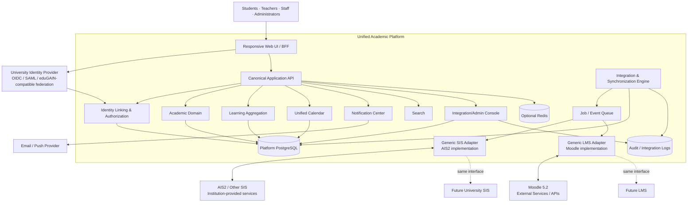
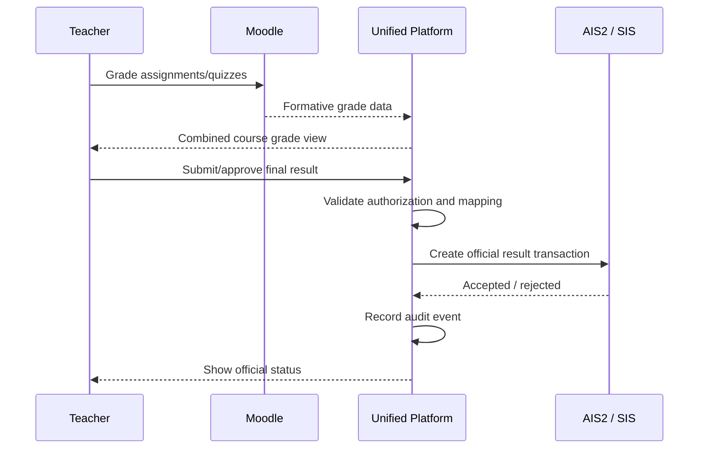
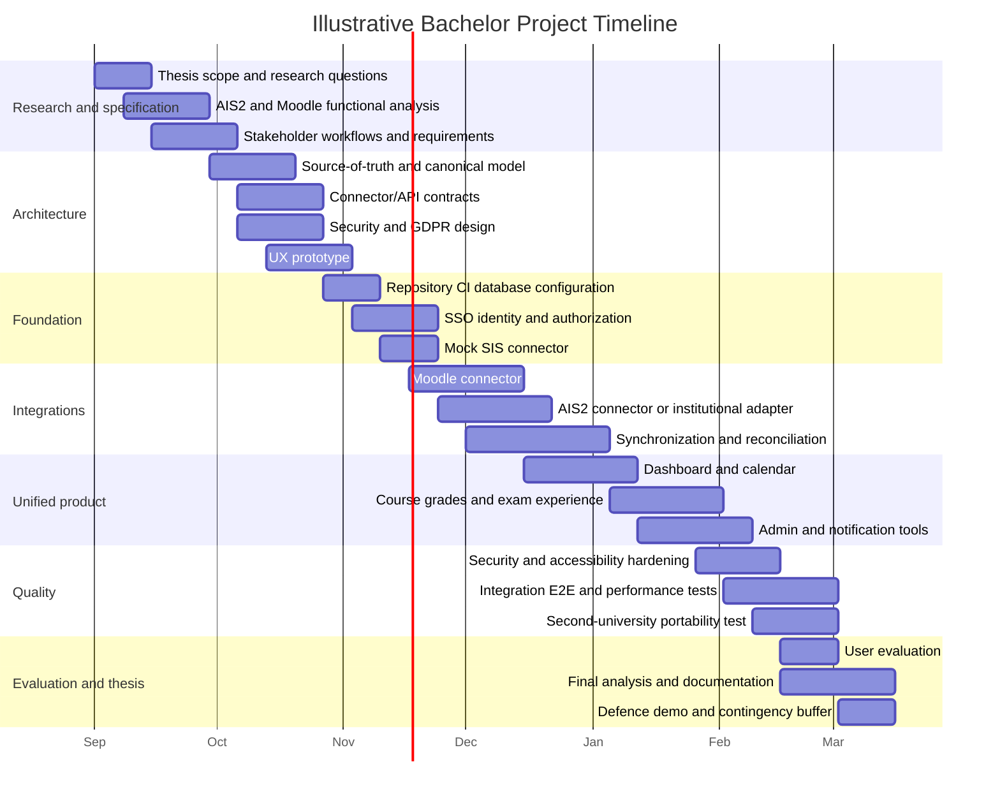

# Bachelor Thesis Project Blueprint: A Reusable Unified Academic Platform for AIS2 and Moodle

## Executive summary

The strongest version of this bachelor thesis is **not a literal clone of AIS2 plus Moodle**. It should be designed as a **reusable Unified Academic Experience Platform** that presents students, teachers, and university staff with one interface while treating existing Student Information Systems and Learning Management Systems as replaceable back-end providers.

That distinction is crucial. AIS2 covers the administrative side of university life: study programs, schedules, study records, admissions, accommodation, administration, reporting, and related university processes. Its official portal also explicitly lists web services for integration with other university-information-system components. citeturn20view0 Moodle covers the learning side: courses, learning materials, assignments, quizzes, forums, grading, completion tracking, notifications, groups, and related teaching workflows. citeturn21view0turn21view1

The combination is not hypothetical. UPJŠ documents exactly this pattern: AIS2 is used for enrolled subjects, schedules, study-program information, theses, accommodation, exam information, and other academic administration, while Moodle is used for course materials, assignments, tests, and teaching activities. UPJŠ also states that students log into Moodle using their AiS login. citeturn20view4turn20view5

That makes the thesis problem academically useful:

> **How can heterogeneous Student Information Systems and Learning Management Systems be unified behind a reusable, configurable platform without creating a new tightly coupled university monolith?**

The recommended architecture is therefore:

**University IdP + SIS/AIS adapter + LMS adapter → canonical academic model → synchronization/integration layer → unified API → unified web application.**

AIS2 becomes the first SIS adapter and Moodle the first LMS adapter. A hypothetical second university should be configurable through alternative adapters without rewriting the application core.

This architecture follows the direction of education-interoperability standards. 1EdTech describes SIS platforms as systems of record for biographical data, catalogues, enrolments, and final outcomes, while LMS platforms contain data such as assignment-level grades and participation; its Edu-API initiative explicitly targets standardized exchange between education administration and teaching/learning systems. citeturn17view5

The thesis should **not depend on gaining unrestricted production AIS2 access**. The official AIS2 material located during this research confirms that integration web services exist, but no public endpoint-level AIS2 API contract comparable to Moodle's developer documentation was found. citeturn20view0 In contrast, Moodle publicly documents External Services and exposes site-specific web-service API documentation through its administration interface. citeturn17view2 Consequently, the safe thesis strategy is to implement:

1. a real Moodle connector against a development Moodle instance;
2. a formal generic SIS connector contract;
3. an AIS2 connector using whatever interfaces the university formally provides;
4. a complete mock AIS2 implementation and realistic test dataset so the thesis remains demonstrable even without production credentials.

As of August 8, 2026, Moodle 5.2 is a current stable branch; the release page lists Moodle 5.2.1 as the latest point release already released by that date, with 5.2.2 dated August 10, 2026. citeturn17view4 Using Moodle 5.2 documentation is therefore an appropriate baseline for the project.

The proposed **P0 thesis MVP** should include SSO, user/role management, academic structures, courses and enrolments, a unified student dashboard, combined timetable/deadline calendar, course overview pages, Moodle activity/deadline integration, SIS schedule/exam/result integration, notifications, configurable institution mappings, synchronization monitoring, audit logging, accessibility, GDPR controls, automated testing, and deployment/documentation. Write operations such as course registration or examination registration should follow only after read synchronization is reliable.

A major thesis contribution should be the explicit separation of **data ownership**:

| Domain                              | Recommended authoritative system |
| ----------------------------------- | -------------------------------- |
| Identity authentication             | University Identity Provider     |
| Student identity/academic status    | SIS/AIS2                         |
| Faculties, programs, academic terms | SIS/AIS2                         |
| Official course catalogue           | SIS/AIS2                         |
| Official enrolment                  | SIS/AIS2                         |
| Timetable                           | SIS/AIS2                         |
| Examination terms                   | SIS/AIS2                         |
| Final official results and credits  | SIS/AIS2                         |
| Learning materials                  | Moodle                           |
| Assignments and quizzes             | Moodle                           |
| Submissions                         | Moodle                           |
| Detailed/formative gradebook        | Moodle                           |
| Activity completion                 | Moodle                           |
| Unified dashboard preferences       | New platform                     |
| Cross-system notifications          | New platform                     |
| Integration mappings and audit data | New platform                     |

This division reflects the typical SIS/LMS responsibility split described by 1EdTech and seen in university implementations. Cornell's LMS evaluation, for example, treated the registrar SIS as the source used for users, courses, sections, and enrolments and highlighted the continuing effort required to transform and synchronize that information into an LMS. citeturn17view5turn24view0

The thesis should evaluate not merely whether the application "works", but whether its architecture is **usable, consistent, secure, portable, and maintainable**. The most convincing experiment is to configure it first for AIS2 + Moodle and then demonstrate that a second synthetic university, with different IDs, terminology, grading rules, organizational structure, and authentication settings, can be onboarded primarily through configuration and a connector rather than changes to core code.

**Recommended working thesis title:**

> **Design and Implementation of a Reusable Unified Academic Platform Integrating Student Information and Learning Management Systems**

A more implementation-specific alternative is:

> **Architecture and Implementation of a Unified University Information Portal Integrating AIS2 and Moodle**

Three useful research questions are:

| Research question                                                                                                                      | How to evaluate it                                                                                                                    |
| -------------------------------------------------------------------------------------------------------------------------------------- | ------------------------------------------------------------------------------------------------------------------------------------- |
| **RQ1:** Can an adapter-based canonical architecture integrate an SIS and LMS without coupling the application core to one university? | Configure AIS2/Moodle implementation and a second simulated university; measure configuration-only reuse and connector-specific code. |
| **RQ2:** Can explicit data ownership and synchronization rules prevent inconsistencies between SIS and LMS data?                       | Run add/drop, grade, schedule, and failure scenarios and measure reconciliation discrepancies.                                        |
| **RQ3:** Does a unified interface reduce the complexity of common academic tasks compared with navigating separate systems?            | User tests measuring completion rate, time, navigation steps, errors, and usability questionnaire results.                            |

The thesis should deliberately avoid claiming to be a full replacement for AIS2 or Moodle. AIS2 includes broad administrative domains such as admissions, accommodation, human resources, administration, and research support, while Moodle itself is a mature extensible LMS with numerous course and administrative capabilities. citeturn20view0turn21view0 Reimplementing both fully would be far beyond a bachelor-project scope. The academically stronger result is a **well-architected integration platform with selected end-to-end workflows and demonstrated extensibility**.

## Research basis and thesis framing

The available evidence strongly supports the architectural premise that SIS and LMS functions overlap but are not interchangeable.

AIS2's official description lists admission procedures, study programs, schedules, study evidence, accommodation, system administration, user administration, human resources, administrative functions, reporting/configuration, electronic applications, national-system interfaces, and web services for university-system integration. It also describes role/function-based access control and multilingual operation. citeturn20view0turn20view2

Current UPJŠ student documentation shows the practical workflows behind those high-level modules: course registration, electronic registration, schedule registration, examination registration, continuous-assessment viewing, thesis registration/administration, questionnaires, fees, identification cards, and related student procedures. citeturn20view6turn20view7 AIS2 also has documented payment-gateway integration for student fees, return slips, and applications. citeturn19view3

Moodle's current documentation covers course materials, assignments, forums, quizzes, workshops, gradebooks, completion tracking, enrolment, groups, notifications, role management, reporting, themes, plugins, imports/exports, and external tools. citeturn21view0turn21view1turn21view2 Moodle's developer APIs additionally expose enrolment, events, external functions/web services, privacy, reporting, search, custom fields, activity completion, groups, grading, and gradebook functionality. citeturn17view3

The UPJŠ implementation illustrates the user-experience problem particularly well: students may need AIS2 for administrative study information and Moodle for learning activities even though the systems share login credentials. citeturn20view4turn20view5 The thesis opportunity is therefore not simply "SSO", because common authentication does not produce a common information architecture, calendar, dashboard, notification system, search experience, or cross-system workflows.

Broader university evidence supports this problem framing. Cornell's LMS evaluation required integration with official university student records for account, course, and enrolment creation, and explicitly noted that migration requires data reformatting, automation, testing, and continuing maintenance. citeturn24view0 A Murdoch University case study described Moodle integrated with its Callista SIS so that enrolment information, including enrolment type and tutorial/workshop allocations, populated the LMS; the same report identified richer SIS/LMS integration as important for learning analytics. citeturn15view1

For interoperability beyond one university, 1EdTech is particularly relevant. Edu-API is aimed directly at standardized exchange among higher-education administrative and teaching systems. citeturn17view5 OneRoster provides standardized roster, course, and grade exchange through CSV and REST, although its official framing is around school-system exchange, making Edu-API the better conceptual target for a higher-education canonical model. citeturn17view6 LTI addresses a different problem: securely launching and connecting learning tools while passing user, enrolment, and role information without requiring another login. citeturn17view7

The result should therefore be considered a **platform architecture**, not an AIS2-specific frontend.

**Relationship to the unspecified original Markdown document.** The original `.md` file requested by the prompt was not included in the material available for this research, so its headings cannot be cited honestly without inventing them. The implementation backlog below therefore uses explicit replacement markers:

| Placeholder used below  | Intended reference in the original MD    |
| ----------------------- | ---------------------------------------- |
| `[ORIG §Scope]`         | Project goals, problem definition, scope |
| `[ORIG §Requirements]`  | Functional/non-functional requirements   |
| `[ORIG §Roles]`         | Actors, permissions, stakeholders        |
| `[ORIG §UX]`            | UI/UX and frontend requirements          |
| `[ORIG §Architecture]`  | Architecture/technology design           |
| `[ORIG §Integration]`   | AIS2/Moodle/API integration              |
| `[ORIG §Data]`          | Database/domain model                    |
| `[ORIG §Security]`      | Authentication/security/GDPR             |
| `[ORIG §Testing]`       | Testing/evaluation                       |
| `[ORIG §Deployment]`    | Hosting/CI/CD/operations                 |
| `[ORIG §Documentation]` | Thesis and technical documentation       |

These are **cross-reference placeholders, not claims about the missing document**. When the actual Markdown is available, each marker can be replaced by the corresponding real heading without changing the task plan.

A useful formal scope boundary is:

| In scope for bachelor thesis            | Explicitly outside initial thesis scope                |
| --------------------------------------- | ------------------------------------------------------ |
| Unified frontend                        | Complete AIS2 replacement                              |
| Authentication federation               | Complete Moodle replacement                            |
| SIS/LMS adapters                        | Reimplementation of all Moodle activity modules        |
| Canonical academic model                | University HR/payroll                                  |
| Courses/enrolments                      | Full scientific/research administration                |
| Timetable and exams                     | National-government integrations                       |
| Moodle activities/deadlines             | Full admissions platform                               |
| Grades/progress overview                | Full accommodation-management platform                 |
| Cross-system calendar                   | Production banking/payment processing                  |
| Notifications                           | Full multi-university commercial SaaS                  |
| Admin/integration console               | Advanced AI student profiling                          |
| Auditing/privacy controls               | Production migration of entire university history      |
| Configuration for multiple institutions | Direct copying of proprietary AIS2 implementation code |

Moodle core is distributed under the GPL and can be modified, although Moodle notes that plugins and third-party add-ons have their own licensing considerations. citeturn19view4 By contrast, the AIS2 sources reviewed expose functional descriptions and integration capability but not a public reusable source-code licence. citeturn20view0 The safer thesis definition is therefore **functional reimplementation and integration**, not copying AIS2 code or branding.

## Functional requirements and prioritized feature map

The priority levels below are intentionally strict:

**P0** means the bachelor project is incomplete without it.  
**P1** creates a strong, demonstrably useful thesis.  
**P2** is a stretch goal after the core architecture works.  
**P3** is future institutional-product scope.

AIS2 and Moodle should not be forced to perform the same jobs. The official AIS2 inventory places study administration, schedules, admissions and related records on the administrative side, while Moodle's documented strengths include course activities, assessment, gradebooks, progress, collaboration and learning content. citeturn20view0turn21view0

| Functional domain             | AIS2 today                                                                                        | Moodle today                                                                                      | Proposed unified behavior                                                              | Authoritative source      | Priority               |
| ----------------------------- | ------------------------------------------------------------------------------------------------- | ------------------------------------------------------------------------------------------------- | -------------------------------------------------------------------------------------- | ------------------------- | ---------------------- |
| **Authentication / SSO**      | University login/role environment; UPJŠ uses AiS credentials for Moodle. citeturn20view5       | Supports multiple authentication approaches including OAuth 2 and Shibboleth. citeturn19view6  | One login into the platform; no separate AIS2/Moodle password handling.                | University IdP            | **P0**                 |
| **User identity**             | User administration and academic identity. citeturn20view0                                     | Moodle user accounts/profile. citeturn21view0                                                  | One person record with external-system identity links.                                 | SIS/IdP                   | **P0**                 |
| **Roles and permissions**     | Role/function-based access control. citeturn20view2                                            | Configurable roles and permissions. citeturn21view0                                            | Canonical scoped RBAC mapped to provider-specific roles.                               | Platform mappings         | **P0**                 |
| **Faculties/departments**     | Faculty-aware university structure. citeturn20view2                                            | Course categories can represent structures but LMS is not the academic system of record.          | Unified organization hierarchy.                                                        | SIS                       | **P0**                 |
| **Study programs/plans**      | Native study-program subsystem. citeturn20view0                                                | Not its core purpose.                                                                             | Program, plan, requirements and progress display.                                      | SIS                       | **P1**                 |
| **Course catalogue**          | Subject/course and study-program information. citeturn20view4                                  | Courses provide learning spaces and materials. citeturn21view1                                 | One course identity linking official course to one or more LMS spaces.                 | SIS for catalogue         | **P0**                 |
| **Course offerings/sections** | Academic offering/registration context. citeturn20view6                                        | Courses, groups and enrolments. citeturn21view1                                                | Model course → offering → section/group explicitly.                                    | SIS                       | **P0**                 |
| **Course registration**       | Documented AIS2 workflow. citeturn20view6                                                      | LMS enrolment is different from official course registration.                                     | Show registration state; later permit controlled SIS write-back.                       | SIS                       | **P1**                 |
| **LMS enrolment**             | Official registration can drive it.                                                               | Moodle provides multiple enrolment methods and plugins. citeturn19view5                        | Automatically reconcile Moodle membership with official enrolment rules.               | SIS → Moodle              | **P0**                 |
| **Timetable**                 | Dedicated schedule subsystem and student schedule registration. citeturn20view0turn20view6    | Calendar supports learning events/deadlines. citeturn21view0                                   | Merge physical timetable and LMS deadlines into one calendar.                          | SIS + LMS                 | **P0**                 |
| **Exam terms**                | Exam registration is documented as a core student workflow. citeturn20view6                    | Quiz/exam activities can exist but are not necessarily registrar exam terms.                      | Display exam terms and registration state alongside learning deadlines.                | SIS                       | **P0 read / P1 write** |
| **Official grades**           | Study evidence/continuous assessment and official academic record. citeturn20view0turn20view6 | Detailed course gradebook. citeturn21view1                                                     | Clearly distinguish formative LMS grades from official SIS results.                    | SIS final result          | **P0**                 |
| **Assignment-level grades**   | May expose continuous assessment in institutional workflows. citeturn20view6                   | Gradebook records assignments, quizzes, workshops and other graded activities. citeturn21view1 | Unified grade view with provenance and status.                                         | Moodle normally           | **P0**                 |
| **Assignments**               | Not the primary teaching-content system in documented UPJŠ use.                                   | Core Moodle functionality. citeturn21view2                                                     | Display status/deadlines and deep-link to native submission page.                      | Moodle                    | **P0**                 |
| **Quizzes/tests**             | Academic assessment records may ultimately be stored administratively.                            | Core Moodle activity. citeturn21view2                                                          | Show upcoming/completed quizzes and result availability.                               | Moodle                    | **P0**                 |
| **Learning resources**        | Course metadata rather than LMS content.                                                          | Files, course materials and external resources. citeturn21view0turn21view1                    | Unified course page links or previews Moodle content without unnecessary duplication.  | Moodle                    | **P0/P1**              |
| **Submissions**               | Not primary repository for Moodle assignments.                                                    | Moodle assignment and assessment workflows. citeturn21view1                                    | Keep submission binaries in Moodle where possible; expose status metadata in platform. | Moodle                    | **P1**                 |
| **Activity completion**       | Academic completion is expressed through official study evidence.                                 | Detailed activity/course completion. citeturn17view3turn21view1                               | Student progress summary combining academic and learning progress.                     | Both, different semantics | **P1**                 |
| **Groups**                    | Schedule/study groups appear in AIS2 student workflows. citeturn20view6                        | Groups/groupings supported for activities and courses. citeturn17view3                         | Explicit group mapping and reconciliation.                                             | Usually SIS               | **P1**                 |
| **Notifications**             | AIS2 communicates exam dates, timetable changes and notices. citeturn20view4                   | Moodle generates assignment/deadline/forum notifications. citeturn21view0                      | Single prioritized notification inbox with source and deep link.                       | Aggregated                | **P0**                 |
| **Academic calendar**         | Timetable, examination events.                                                                    | Activities, calendar and timeline deadlines. citeturn21view0                                   | Single filterable calendar with conflict detection.                                    | Aggregated                | **P0**                 |
| **Messaging/discussions**     | AIS2 student tutorials include discussion functionality. citeturn20view6                       | Messaging and forums are first-class Moodle features. citeturn21view0                          | Aggregate notices; avoid attempting to mirror every discussion thread in MVP.          | Source systems            | **P1/P2**              |
| **Thesis management**         | Thesis registration, assignment printing and administration are documented. citeturn20view6    | Can support materials/workflows but is not thesis registry.                                       | Thesis status, supervisor, deadlines and source links.                                 | SIS                       | **P2**                 |
| **Fees**                      | Student fee checking and payment gateway are documented. citeturn20view7turn19view3           | Not registrar-finance system.                                                                     | Read-only fee summary and secure redirection to official payment.                      | SIS/payment system        | **P2**                 |
| **Admissions**                | Native AIS2 subsystem and electronic applications. citeturn20view0                             | Not core LMS purpose.                                                                             | Applicant portal in future architecture.                                               | SIS                       | **P3**                 |
| **Accommodation**             | Native subsystem/applications. citeturn20view0turn20view4                                     | Not LMS function.                                                                                 | Optional institution module.                                                           | SIS/accommodation         | **P3**                 |
| **Questionnaires**            | Student workflow documented in AIS2. citeturn20view6                                           | Feedback/survey-type learning activities are supported. citeturn21view0                        | Unified discovery rather than duplicate engines.                                       | Either                    | **P2**                 |
| **Research/HR**               | AIS2 scope includes science/research support and HR. citeturn20view0                           | Outside core LMS scope.                                                                           | Extension interface only in thesis.                                                    | Institutional systems     | **P3**                 |
| **Reporting**                 | Reports/configuration subsystem. citeturn20view0                                               | Site/course reporting and Report Builder API. citeturn21view0turn17view3                      | Role-specific cross-system reports.                                                    | Aggregated                | **P1**                 |
| **Search**                    | University-specific.                                                                              | Moodle has Search API. citeturn17view3                                                         | Search courses, people where authorized, activities, pages and administrative objects. | Search index              | **P1**                 |
| **Mobile UX**                 | Browser application.                                                                              | Responsive interface and Moodle mobile capabilities. citeturn21view0                           | Responsive web app/PWA-style UX rather than native apps initially.                     | Platform                  | **P0**                 |
| **Administration**            | System/user administration and configurations. citeturn20view0                                 | Users, courses, themes, plugins and site administration. citeturn21view2                       | New integration-specific admin console, without replacing source administrators.       | Platform                  | **P0**                 |

The **student dashboard** should be the project's central UX contribution. It should answer, without forcing navigation through separate systems:

- What classes do I have today?
- What assignments and quizzes are due?
- Which examination registrations are open?
- Have any timetable or room changes occurred?
- What new grades are available?
- Which courses require attention?
- What administrative obligations are outstanding?
- What announcements are important?
- What is the status of my study progress?

Moodle already has a dashboard/timeline concept for learning deadlines, while AIS2 supplies administrative schedule and exam information; the new contribution is cross-system aggregation rather than recreating either independently. citeturn21view0turn20view4

A recommended **course 360° page** is:

```text
Software Engineering
────────────────────────────────────────────────────────────

Official information                 Learning
AIS/SIS                              Moodle
────────────────────                 ────────────────────────
Course code                          Moodle course
ECTS                                 Resources
Programme requirements               Assignments
Teachers                             Quizzes
Official enrolment                   Forums
Schedule                             Completion
Exam terms                           Formative grades
Official result                      Feedback

────────────────────────────────────────────────────────────
Upcoming
Mon 09:00  Lecture · Room A12
Tue 23:59  Assignment 4 due
Fri 10:00  Exam registration opens

Progress
Moodle activities: 13 / 18
Current formative score: 82 %
Official final grade: Not yet recorded
```

Every externally sourced element should display **provenance**—for example `AIS2`, `Moodle`, or `Unified Platform`—and, when useful, a `last synchronized` timestamp. This both improves user trust and makes inconsistent integration data much easier to diagnose.

The role model should be more granular than merely `student / teacher / administrator`. AIS2 itself uses role/function-based access concepts, and Moodle supports configurable roles and permissions. citeturn20view2turn21view0

| Canonical role            | Typical scope                | Important permissions                                      |
| ------------------------- | ---------------------------- | ---------------------------------------------------------- |
| Applicant                 | Application                  | Application status only                                    |
| Student                   | Own study + enrolled courses | Own timetable, activities, registrations, grades           |
| Teacher                   | Assigned offerings           | Roster and course-learning information                     |
| Course coordinator        | Course/offering              | Wider course-management and result workflows               |
| Teaching assistant        | Assigned group/section       | Restricted grading/content according to policy             |
| Thesis supervisor         | Assigned theses              | Thesis progress and supervision                            |
| Study officer / registrar | Faculty/program              | Academic records and registrations                         |
| Faculty administrator     | Faculty                      | Configuration/reporting in faculty scope                   |
| Finance officer           | Finance domain               | Fees only, not learning submissions                        |
| Accommodation officer     | Accommodation domain         | Accommodation only                                         |
| Integration operator      | Connector/institution        | Synchronization and mappings, not arbitrary academic edits |
| System administrator      | Technical platform           | Infrastructure/configuration                               |
| Auditor / DPO             | Audit/privacy scope          | Logs/privacy records, normally read-only                   |
| Support agent             | Limited support scope        | Diagnostic information with sensitive-data restrictions    |

Cornell's institutional LMS evaluation also illustrates why fine-grained role control matters: course-level responsibilities such as teaching assistants can require more restricted grade access than full instructors. citeturn16view0

The most important end-to-end workflows should be explicitly specified before coding:

| Workflow                           | Minimum end-to-end behavior                                              | Priority |
| ---------------------------------- | ------------------------------------------------------------------------ | -------- |
| Student login                      | IdP → platform → identity mapping → role-specific dashboard              | P0       |
| Semester enrolment synchronization | SIS registration → canonical enrolment → Moodle enrolment reconciliation | P0       |
| Add/drop                           | SIS state changes → synchronization → Moodle membership update → audit   | P0       |
| Daily study                        | Dashboard → course → timetable/activity/deadline → source action         | P0       |
| Exam discovery                     | Course → eligible exam terms → registration state                        | P0       |
| Exam registration                  | Validate state → SIS write → confirmation → audit/idempotency            | P1       |
| Grade viewing                      | Moodle formative results + SIS official grade with clear labels          | P0       |
| Teacher roster                     | SIS-authoritative class list + group mapping                             | P0/P1    |
| Teacher assessment                 | Learning assessment remains Moodle-native                                | P0       |
| Final result                       | Teacher-approved result → registrar/SIS according to university rules    | P2       |
| Timetable change                   | SIS change → synchronization → calendar update → notification            | P1       |
| New Moodle deadline                | Moodle → synchronization/event → calendar + notification                 | P0       |
| Integration failure                | Job fails → retry → administrator alert → reconciliation interface       | P0       |
| Privacy request                    | Request → identify platform-held data → export/review workflow           | P1       |
| New university onboarding          | New configuration + connectors + mappings → validation → test import     | P1       |

## Integration architecture, APIs, and data model

The recommended architecture is a **modular monolith with strict connector boundaries**, rather than a fleet of microservices. This is a design recommendation based on bachelor-project scope: the platform can preserve logical modules while remaining straightforward to develop, test, deploy, and demonstrate. A later institutional implementation could split high-load modules without changing the conceptual boundaries.



AIS2's official documentation confirms the existence of web services for integrating it with other university information-system components, but the material located in this research does **not** provide a public developer contract with endpoint names, request schemas, authentication instructions, or versioning semantics. citeturn20view0 Therefore, no thesis design should invent calls such as `/ais2/api/students`. Those belong only in the concrete adapter after obtaining real institutional integration documentation.

Moodle is substantially more open from an integration-development perspective. Its External Service API documents how web services and external functions are built, and each Moodle installation can expose documentation for the web-service functions available on that site. citeturn17view2 Moodle's current API catalog includes enrolment, events, external functions, Privacy API, reporting, search, custom fields, activity completion, groups and gradebook APIs. citeturn17view3

| Integration surface                         | Purpose                                                                                                        | Read/write suitability                                                 | Portability                 | Thesis use                                                   |
| ------------------------------------------- | -------------------------------------------------------------------------------------------------------------- | ---------------------------------------------------------------------- | --------------------------- | ------------------------------------------------------------ |
| **AIS2 web services**                       | Integration with university systems is officially supported. citeturn20view0                                | Depends on institution-provided contract                               | AIS2-specific               | AIS2 connector                                               |
| **Moodle External Services / Web Services** | External applications invoke exposed Moodle functions. citeturn17view2turn17view3                          | Read/write according to enabled functions and permissions              | Moodle-specific             | Primary Moodle connector                                     |
| **Moodle Enrolment API/plugins**            | Participant/enrolment integration. citeturn17view3turn19view5                                              | Both                                                                   | Moodle-specific             | Roster synchronization                                       |
| **Moodle Gradebook API**                    | Read/write gradebook information. citeturn17view3                                                           | Both                                                                   | Moodle-specific             | Grade aggregation                                            |
| **Moodle Events API**                       | Event handlers and Moodle internal event model. citeturn17view3                                             | Event consumption through appropriate plugin/integration design        | Moodle-specific             | Optional near-real-time connector                            |
| **Moodle Privacy API**                      | Discover/export/delete plugin-held personal data. citeturn17view3                                           | Privacy lifecycle                                                      | Moodle-specific             | Required if implementing Moodle plugin storing personal data |
| **1EdTech Edu-API**                         | Standard exchange of education enterprise data between administrative and learning systems. citeturn17view5 | Data exchange contract                                                 | High conceptual portability | Basis for canonical model                                    |
| **OneRoster**                               | Roster/course/grade exchange via CSV or REST. citeturn17view6                                               | Both depending profile                                                 | Standardized                | Optional compatibility/import format                         |
| **LTI**                                     | Secure learning-tool integration and transfer of user/enrolment/role context. citeturn17view7               | Tool launch/services, not replacement for complete SIS synchronization | High                        | Future external-tool integration                             |
| **OpenID Connect**                          | Authentication layer built on OAuth 2.0 with identity claims. citeturn17view8                               | Authentication                                                         | High                        | Preferred modern SSO interface                               |
| **SAML 2.0**                                | Federated exchange of authentication/security information. citeturn17view9                                  | Authentication/federation                                              | High                        | University federation adapter                                |
| **eduGAIN**                                 | Federates research/education identity providers and services internationally. citeturn19view8               | Authentication federation                                              | Very high                   | Optional academic-federation deployment                      |

**Recommended authentication design:** in an institutional deployment the platform should be an **OIDC relying party**, with a SAML/Shibboleth-compatible option where the university identity infrastructure requires it. OpenID Connect explicitly provides authentication on top of OAuth 2.0 and identity claims. citeturn17view8 SAML remains relevant for federation, and eduGAIN connects education/research identity federations internationally. citeturn17view9turn19view8

Moodle itself supports OAuth-based authentication and lists Shibboleth as an authentication mechanism, strengthening the case for federation rather than password synchronization. citeturn19view6

**What is implemented today differs, deliberately, and the thesis should say so rather than describe an OIDC-only design the project does not have.** The platform currently authenticates with first-party credentials: argon2-hashed passwords, a 15-minute access JWT carrying a `token_version` claim, and an opaque refresh token stored only as a SHA-256 digest and rotated on every use, with reuse detection revoking the entire token family (ADR 0003). The rationale is that a bachelor project cannot assume it will be granted a client registration on the university IdP, and an authentication layer that only works against infrastructure the author may never receive access to is not demonstrable at a defence.

The correct framing is therefore **pluggable authentication with a local strategy as the development default**:

| Concern                   | Position                                                                                                                                                  |
| ------------------------- | --------------------------------------------------------------------------------------------------------------------------------------------------------- |
| Local credential strategy | Development, demo and contingency-defence path; also the seam that keeps the platform testable without an external IdP                                    |
| OIDC strategy             | The production path. Added as an additional Passport strategy resolving into the same `ExternalIdentity` linking step — not a rewrite of session handling |
| Session mechanics         | Identical under both strategies: the access/refresh pair is minted by the platform once a strategy has established identity                               |
| SAML strategy             | Adapter, only where the target federation requires it                                                                                                     |

Two invariants hold regardless of strategy, and these are what the security chapter should actually defend:

- The platform must **never hold or proxy a user's AIS2 or Moodle password**. Connector access is service-credential or token based, configured per institution and held outside source control; source-system user credentials never enter the platform.
- Where an institutional IdP is present, **local credentials must be disabled for that institution** rather than kept as a parallel login path. Two ways in means the weaker one sets the security level.

For administrative accounts, MFA should be enforced through the institution's identity system where available; Moodle also provides configurable MFA support on its side. citeturn19view7

The canonical data model is the mechanism that makes this reusable.

| Entity                 | Important fields                                             | Why it belongs in canonical model |
| ---------------------- | ------------------------------------------------------------ | --------------------------------- |
| `Institution`          | `id`, `code`, `name`, `timezone`, `locales`, branding        | Multi-university boundary         |
| `OrgUnit`              | `id`, `parentId`, `type`, `name`                             | Faculty/department hierarchy      |
| `Person`               | internal UUID, display identity, institutional email, status | Provider-independent person       |
| `ExternalIdentity`     | `personId`, `provider`, `subject`, `externalUserId`          | Maps one person to IdP/SIS/LMS    |
| `RoleAssignment`       | person, role, scope, validity                                | Scoped authorization              |
| `AcademicTerm`         | code, start/end dates, registration dates                    | Semester abstraction              |
| `Program`              | program ID, degree level, organization                       | Academic program                  |
| `StudyPlan`            | version, program, requirements                               | Degree planning                   |
| `Course`               | code, title, credits, department                             | Stable catalogue object           |
| `CourseOffering`       | course, term, section, teachers, external IDs                | Actual delivered class            |
| `Enrollment`           | person, offering, role, status, group, dates                 | Central SIS/LMS relation          |
| `Group`                | offering, type, external mappings                            | Tutorial/lab/LMS grouping         |
| `Room`                 | campus/building/room                                         | Scheduling                        |
| `TimetableEvent`       | offering/group, start/end, room, recurrence                  | Physical schedule                 |
| `ExamTerm`             | offering, date/time, room, capacity, registration interval   | Registrar examination             |
| `LearningActivity`     | offering, Moodle activity ID, type, due date                 | LMS activity metadata             |
| `Assessment`           | activity/type, points, weight, source                        | Assessment definition             |
| `AssessmentResult`     | person, assessment, score/grade, source                      | Formative learning result         |
| `OfficialCourseResult` | enrollment, grade, credits, attempt, status                  | Official SIS outcome              |
| `SubmissionRef`        | activity, person, state, source reference                    | Avoid unnecessary file copying    |
| `Thesis`               | student, supervisor, topic, status, deadlines                | Optional administrative module    |
| `Fee`                  | student, category, amount/status/reference                   | Optional finance display          |
| `Announcement`         | source, scope, priority, publication interval                | Cross-system communication        |
| `Notification`         | recipient, event, read state, delivery state                 | Unified notification center       |
| `UserPreference`       | locale, notification choices, dashboard layout               | Platform-owned data               |
| `SyncCursor`           | connector/entity/type/cursor                                 | Incremental synchronization       |
| `SyncJob`              | status, counters, timestamps                                 | Operational administration        |
| `IntegrationError`     | job, object, reason, retry state                             | Reconciliation                    |
| `AuditEvent`           | actor, action, object, timestamp, result                     | Accountability/security           |

Every synchronized entity should contain integration metadata conceptually equivalent to:

```json
{
  "id": "1f3b89fb-d514-4ce8-b945-8e4cb6a78457",
  "institutionId": "upjs",
  "source": {
    "system": "AIS2",
    "externalId": "external-value-from-provider"
  },
  "sourceUpdatedAt": "2026-08-08T09:42:15Z",
  "lastSynchronizedAt": "2026-08-08T09:43:01Z",
  "sourceVersion": "provider-version-or-etag-if-available",
  "deleted": false
}
```

The values and field names above are a **proposed internal contract**, not AIS2's actual API schema.

For portability, external identifiers must never become primary keys. For example:

```text
Wrong:
CourseOffering primary key = Moodle course ID 7152

Correct:
Platform UUID = 8a8d...
ExternalSystemMapping:
    provider = moodle
    entity = course
    external_id = 7152
```

That single rule dramatically reduces coupling when universities migrate LMS products or have multiple Moodle instances.

The major data flows should be specified before implementing APIs:

| Data                  | Direction                                | Frequency                               | Conflict policy                      |
| --------------------- | ---------------------------------------- | --------------------------------------- | ------------------------------------ |
| People/status         | SIS → platform                           | Incremental/nightly + requested refresh | SIS wins                             |
| Identity claims       | IdP → platform                           | Login-time                              | IdP wins for authentication identity |
| Organizations         | SIS → platform                           | Daily/configured                        | SIS wins                             |
| Academic terms        | SIS → platform                           | Daily                                   | SIS wins                             |
| Course catalogue      | SIS → platform                           | Daily                                   | SIS wins                             |
| Course offerings      | SIS → platform                           | Frequent during semester setup          | SIS wins                             |
| Enrolments/add/drop   | SIS → platform                           | Frequent / event-driven where possible  | SIS wins                             |
| Moodle course linkage | Moodle ↔ platform mapping                | Provisioning + reconciliation           | Mapping rules                        |
| LMS enrolment         | Platform/SIS → Moodle                    | Frequent                                | SIS eligibility wins                 |
| Groups                | SIS → platform → Moodle where applicable | Frequent                                | Explicit mapping                     |
| Timetable             | SIS → platform                           | Frequent                                | SIS wins                             |
| Exam terms            | SIS → platform                           | Frequent                                | SIS wins                             |
| Exam registration     | Platform → SIS                           | Transactional                           | SIS validates and commits            |
| Moodle activities     | Moodle → platform                        | Incremental                             | Moodle wins                          |
| Deadlines             | Moodle → platform                        | Incremental                             | Moodle wins                          |
| Completion            | Moodle → platform                        | Incremental                             | Moodle wins                          |
| Formative grades      | Moodle → platform                        | Incremental                             | Moodle wins                          |
| Official grades       | SIS → platform                           | Incremental                             | SIS wins                             |
| Submission binaries   | Remain in Moodle                         | No replication by default               | Moodle                               |
| Submission status     | Moodle → platform                        | Incremental                             | Moodle wins                          |
| Fees                  | SIS → platform                           | Daily/on-demand                         | SIS wins                             |
| Payment               | Platform → official gateway/deep link    | Transactional redirect                  | Payment/SIS system wins              |
| Notices               | SIS/Moodle → platform                    | Incremental                             | Preserve source                      |
| Preferences           | Platform only                            | Immediate                               | Platform wins                        |

The platform must avoid the classic **dual-master problem**. A Moodle grade and an AIS2 official grade are not automatically the same domain object. Moodle may contain a formative weighted gradebook while the SIS contains the legally/administratively recognized result. Moodle's documentation explicitly supports detailed gradebooks and multiple graded activity types; SIS-style systems serve final-outcome functions. citeturn21view1turn17view5

A safe grade workflow is therefore:



For the bachelor MVP, the final `U → SIS` operation can remain a simulated transaction if AIS2 does not expose an approved write API.

The connector interface should look conceptually like this:

```text
AcademicSystemConnector
    healthCheck()
    capabilities()

    getPersons(changedSince)
    getOrgUnits(changedSince)
    getAcademicTerms(changedSince)
    getPrograms(changedSince)
    getCourses(changedSince)
    getCourseOfferings(changedSince)
    getEnrollments(changedSince)
    getGroups(changedSince)
    getTimetableEvents(changedSince)
    getExamTerms(changedSince)
    getOfficialResults(changedSince)

    registerForExam(command)      // optional capability
    registerForCourse(command)    // optional capability

LearningSystemConnector
    healthCheck()
    capabilities()

    getCourses(changedSince)
    getEnrollments(changedSince)
    getActivities(changedSince)
    getDeadlines(changedSince)
    getCompletion(changedSince)
    getGrades(changedSince)
    getSubmissionMetadata(changedSince)

    provisionCourse(command)      // optional
    upsertEnrollment(command)     // optional
```

The important part is the `capabilities()` concept. A university's SIS connector may return:

```json
{
  "examTerms.read": true,
  "examRegistration.write": false,
  "courseRegistration.write": false,
  "fees.read": true,
  "theses.read": true
}
```

The UI then disables or deep-links unsupported operations instead of embedding AIS2-specific assumptions in core code.

This is the foundation for true reuse.

## Security, privacy, UX, scalability, customization, and deployment

A system aggregating SIS and LMS information becomes a particularly sensitive application because one interface can expose identity, enrolment, grades, schedules, submissions, academic status and potentially finance information. Its security design therefore belongs in the thesis architecture rather than as a final testing task.

GDPR Article 25 establishes data protection by design and by default, including measures that reduce processing to what is necessary; Article 32 requires risk-appropriate technical and organizational security, and Article 35 requires assessment of processing likely to result in high risk, particularly where new technologies and the processing context create such risk. citeturn18search1turn18search12turn18search7

For this project that means:

| Requirement                | Thesis implementation                                                                                                     |
| -------------------------- | ------------------------------------------------------------------------------------------------------------------------- |
| **Data minimization**      | Do not mirror all AIS2/Moodle tables. Store only fields needed for unified functionality.                                 |
| **Purpose limitation**     | Each canonical field must have a documented purpose.                                                                      |
| **Privacy by default**     | Users see only data within their role/scope.                                                                              |
| **Retention**              | Define retention per platform-owned entity; do not invent deletion rules for official academic records.                   |
| **Data-subject workflows** | Support export/discovery of platform-held personal data and an administrative request workflow.                           |
| **Encryption in transit**  | HTTPS/TLS for browser, IdP and connectors.                                                                                |
| **Secret protection**      | Connector/API credentials outside source control, preferably secret-management/environment injection.                     |
| **Sensitive logging**      | Never log passwords, access tokens, full submission content or unnecessary personal fields.                               |
| **Auditability**           | Record privileged views/changes, integration write operations, role changes and administrative actions.                   |
| **Pseudonymized testing**  | Use synthetic or anonymized student datasets in development and thesis evaluation.                                        |
| **DPIA screening**         | Document whether the processing reaches Article 35 high-risk criteria; especially reassess before analytics/AI profiling. |
| **DPO consultation**       | Treat institutional privacy/DPO review as a deployment prerequisite for production use.                                   |

If a Moodle plugin is developed and it stores personal data, Moodle's Privacy API is specifically intended to describe stored personal data and support discovery, export and deletion operations. citeturn17view3

OWASP ASVS should be adopted as a formal application-security acceptance framework rather than relying on an informal "security test." OWASP describes ASVS as a basis both for testing web-application security controls and for specifying secure-development requirements. citeturn17view14

A reasonable thesis security checklist includes:

| Security area         | Required controls/tests                                                                |
| --------------------- | -------------------------------------------------------------------------------------- |
| Authentication        | OIDC/SAML validation, secure callbacks, logout behavior, no local password duplication |
| Authorization         | Server-side RBAC/ABAC checks on every protected operation                              |
| Admin security        | MFA through IdP, least privilege, separate privileged roles                            |
| Sessions              | Secure/HttpOnly/SameSite cookies; rotation after authentication                        |
| CSRF                  | CSRF defenses for browser write operations                                             |
| XSS                   | Output encoding/sanitization; CSP where practical                                      |
| Injection             | Parameterized DB access; input validation                                              |
| API security          | Scope/role validation; rate limits for expensive operations                            |
| Connector credentials | Secret storage, rotation strategy                                                      |
| Write-back            | Idempotency keys, validation, confirmation, audit                                      |
| Audit logs            | Append-oriented security/audit events with restricted access                           |
| Dependencies          | Automated vulnerability/dependency scanning                                            |
| CI                    | Static checks, tests, dependency checks before deployment                              |
| Backups               | Database backup and documented restoration test                                        |
| Failure isolation     | Connector outage must not expose stale data as current                                 |
| Error handling        | User-safe errors; internal correlation ID for diagnostics                              |

Authorization should be **scoped**, not only role-based:

```text
Teacher
└── can read students
    └── only in CourseOffering X
        └── and only fields allowed to instructors

StudyOfficer
└── can manage academic records
    └── only in Faculty Y

IntegrationOperator
└── can retry synchronization
    └── but cannot alter a student's official grade
```

This prevents the common anti-pattern where any person with an "admin-like" role can access every student's academic information.

For SSO, OIDC should be preferred as the default modern application contract because the standard explicitly defines authentication and end-user claims on top of OAuth 2.0. citeturn17view8 SAML remains a necessary adapter option for university federation environments, and eduGAIN exists specifically to connect identity providers and services across research and education federations. citeturn17view9turn19view8

The UI/UX should be built around **tasks rather than source systems**. The main menu should therefore not be:

```text
AIS2
Moodle
```

It should instead be:

```text
Home
My Studies
Courses
Calendar
Assessments
Exams
Grades
Messages
Documents
Services
```

The source system should normally be implementation detail, exposed only as provenance and where the user must continue an action in the native system.

A recommended navigation model is:

```text
Home
├── Today's classes
├── Upcoming deadlines
├── Open exam registrations
├── New results
├── Important notices
└── Attention required

My Studies
├── Programme
├── Progress / credits
├── Enrolments
├── Study plan
└── Official results

Courses
└── Course
    ├── Overview
    ├── Schedule
    ├── Learning
    ├── Assessments
    ├── Grades
    ├── Exams
    └── People

Calendar
├── Classes
├── Deadlines
├── Exams
└── University events

Administration
├── Institution configuration
├── Connectors
├── Mappings
├── Synchronization
├── Errors
├── Audit
└── Privacy
```

Accessibility should be a measurable acceptance criterion rather than cosmetic polish. WCAG 2.2 provides testable requirements across desktop and mobile web content and extends previous WCAG versions. citeturn17view15 The project should target **WCAG 2.2 AA** and include keyboard-only navigation, visible focus, semantic HTML, accessible forms and errors, sufficient contrast, screen-reader-oriented labels, meaningful heading structure, responsive reflow, and reduced unnecessary motion.

Internationalization also belongs in the architecture. AIS2 itself documents multilingual operation, while Moodle supports multilingual configurations. citeturn20view0turn21view0 Therefore:

```text
Do not:
    label = "Faculty"
    semester = "Winter semester"
    grading = ["A", "B", "C", "D", "E", "FX"]

Prefer:
    terminology.faculty = institution-configured translation
    academicTerm.label = imported/configured
    gradingScheme = institution-configured
```

The following should be institution configuration, not hard-coded logic:

| Configuration area       | Examples                                       |
| ------------------------ | ---------------------------------------------- |
| Branding                 | Name, logo, favicon, visual tokens             |
| Language                 | Slovak, English, Czech, etc.                   |
| Time zone                | Europe/Bratislava or other                     |
| Academic terminology     | Faculty/school/college, subject/course/module  |
| Organizational hierarchy | University → faculty → institute → department  |
| Academic calendar        | Semester names and dates                       |
| Grading                  | A–FX, numeric, pass/fail, local mappings       |
| Credits                  | ECTS or institution-specific                   |
| Role mapping             | AIS2 role → canonical role → Moodle role       |
| Connector fields         | External identifiers and mapping rules         |
| Features                 | Exams enabled, accommodation disabled, etc.    |
| Notifications            | Channels, templates, priorities                |
| Authentication           | OIDC/SAML provider metadata                    |
| Retention                | Platform-owned logs/cache durations            |
| Integrations             | Moodle URL, AIS/SIS adapter, optional services |

For the bachelor implementation, the best compromise is **single-institution deployment with multi-institution-ready data structures**, rather than immediately hosting several real universities in one database. Every canonical record can contain `institution_id`, but each university can initially deploy an isolated instance. This keeps the reusable architecture demonstrable without adding the privacy and operational complexity of production shared-tenancy.

The admin console is a core feature, not a secondary convenience. Without it, every integration problem becomes a developer problem.

It should expose:

| Admin tool               | Purpose                                             |
| ------------------------ | --------------------------------------------------- |
| Connector status         | Is AIS2/Moodle reachable?                           |
| Capability discovery     | Which read/write operations does connector support? |
| Credential configuration | Secure integration configuration                    |
| External ID browser      | View canonical ↔ provider mapping                   |
| Role mapping             | Configure SIS/LMS → platform roles                  |
| Field mapping            | Map provider fields into canonical schema           |
| Dry-run import           | Show what would change without committing           |
| Sync jobs                | Running/completed/failed jobs                       |
| Job details              | Read/create/update/delete/error counts              |
| Retry                    | Re-run failed objects safely                        |
| Reconciliation           | Compare source and target populations               |
| Conflict queue           | Objects requiring administrator decision            |
| Sync freshness           | Last successful update per data domain              |
| Feature flags            | Institution-specific modules                        |
| Academic terms           | Enable/current/archive                              |
| Notification templates   | Institution-specific notices                        |
| Audit viewer             | Authorized view of privileged actions               |
| Privacy tools            | Export/retention workflow                           |
| Maintenance mode         | Safe deployment/import operations                   |

For scale, Moodle's own documentation notes that deployment size can range from small installations to clustered/cloud deployments and recommends learning from a smaller pilot for very large installations. citeturn19view9 Moodle also documents scaling to many thousands of users with appropriate performance engineering and identifies Redis as an option for application/session caching. citeturn17view16turn17view17

The new platform should therefore be designed for horizontal growth without prematurely optimizing:

```text
Browser
   │
Load balancer / reverse proxy
   │
┌──────────────┬──────────────┐
│ App instance │ App instance │   stateless application
└──────────────┴──────────────┘
        │
   PostgreSQL
        │
 Optional Redis
        │
 Integration job queue
        │
 AIS2 / Moodle
```

The most important scalability mechanism is actually **asynchrony**. Loading a dashboard should not cause twenty live calls to AIS2 and Moodle. The integration layer should synchronize/cache appropriate metadata and use controlled on-demand refresh for information that must be current.

Recommended deployment environments:

```text
local
  ├─ synthetic SIS adapter
  ├─ local Moodle
  └─ local database

test / CI
  ├─ deterministic fixtures
  ├─ Moodle test instance
  └─ automatic integration tests

staging
  ├─ university test identity provider
  ├─ AIS2 test connector if available
  ├─ Moodle staging
  └─ production-like monitoring

production
  ├─ institutional IdP
  ├─ production APIs
  ├─ backups
  ├─ monitoring
  └─ controlled secrets
```

The architecture itself is language-neutral — it could be implemented in Java/Kotlin, C#/.NET, TypeScript/Node, Python or PHP, and the thesis should present the selection criteria (maintainability, ecosystem, type safety, testing, authentication libraries, deployment support) rather than presenting the stack as self-evident.

For this implementation the selection has been made and is **TypeScript end to end**, which keeps one type system and one set of DTO definitions across the API contract and the client. The table below records what is actually in the repository, not an aspiration:

| Layer            | Requirement                                           | Chosen implementation                                                                                                                  |
| ---------------- | ----------------------------------------------------- | -------------------------------------------------------------------------------------------------------------------------------------- |
| Frontend         | Component-based responsive web framework              | Next.js 16 App Router, React 19, Feature-Sliced Design (`steiger`-enforced), Tailwind + shadcn/ui                                      |
| Client data      | Server-state cache, not hand-rolled fetching          | TanStack Query over a generated typed API client                                                                                       |
| BFF              | Browser never holds API tokens                        | Next.js route handlers re-issue platform tokens as httpOnly cookies on their own origin                                                |
| Backend          | Typed or strongly validated application API           | NestJS 11 on Fastify, `ROLE=api\|worker\|all`                                                                                          |
| Validation       | Boundary validation, not defensive checks in services | `class-validator`/`class-transformer` DTOs; Zod for environment                                                                        |
| API              | REST/JSON is sufficient for thesis                    | REST + `@nestjs/swagger`, `openapi.json` committed and CI-diffed                                                                       |
| Database         | Relational database, preferably PostgreSQL-class      | PostgreSQL 17 via `postgres` driver                                                                                                    |
| Data access      | Typed schema, reviewable migrations                   | Drizzle ORM + `drizzle-kit`; repositories go through `TransactionHost`                                                                 |
| Cache            | Optional Redis-class cache                            | Redis 7 (`cache-manager`/Keyv, throttler storage, distributed lock)                                                                    |
| Async work       | Background job queue                                  | BullMQ on Redis, with a shared `BaseProcessor`                                                                                         |
| Idempotency      | Safe retry of write operations                        | `Idempotency-Key` interceptor backed by Redis                                                                                          |
| Authentication   | See the authentication section below                  | First-party JWT (15 min) + rotating opaque refresh tokens, argon2 password hashing; OIDC added as an additional strategy               |
| Containerization | OCI/Docker-style images                               | Multi-stage `Dockerfile`, `docker-compose.yml` for Postgres/Redis/app                                                                  |
| CI/CD            | Automated build, tests, security checks               | GitHub Actions: lint, typecheck, test, OpenAPI drift, migration check, build; pnpm audit, CodeQL, Trivy image scan; release publishing |
| Observability    | Structured logs, metrics, correlation IDs             | `nestjs-pino`, Prometheus via `@willsoto/nestjs-prometheus`, Terminus health checks; OTLP endpoint reserved in env                     |
| Testing          | Unit plus real-dependency integration tests           | Vitest (`unit`/`e2e` projects), Testcontainers-backed Postgres, Playwright on the frontend                                             |
| Deployment       | VM/container/cloud-neutral                            | Container image; no cloud-specific service dependency                                                                                  |

Two deliberate deviations from the generic recommendation deserve a thesis note. First, **an ORM with a hand-written migration trail** was preferred over schema auto-synchronization, because the canonical model is the thesis contribution and its evolution should be reviewable. Second, **Redis is not optional here** — it backs the job queue, the rate-limit store and the idempotency records, so the deployment topology has two stateful dependencies rather than one.

## Step-by-step implementation backlog and migration strategy

Effort below describes a **single bachelor student developer** and is relative:

- **Low:** roughly one to three focused development days.
- **Medium:** roughly four to eight days.
- **High:** roughly nine to fifteen or more days, usually with significant uncertainty.

These are planning estimates rather than promises; API access and university-specific requirements can change them substantially.

**Status legend.** `Done` — delivered and in the repository. `Partial` — a usable foundation exists but the step's stated deliverable is not met; the cell says what is missing. `Design only` — specified in `docs/System Plan.md` or this document, no code. `Open` — not started.

The status column reflects the repository as of August 2026 and should be re-read before it is quoted in the thesis. Summarized:

| Area                           | Where the project stands                                                                                                                                                                                                                                                       |
| ------------------------------ | ------------------------------------------------------------------------------------------------------------------------------------------------------------------------------------------------------------------------------------------------------------------------------ |
| Application skeleton           | Complete. NestJS 11 on Fastify, modular monolith (ADR 0002), `ROLE=api\|worker\|all`, Zod-validated environment, graceful shutdown, request timeouts, compression, Helmet, CORS, body limits                                                                                   |
| Persistence                    | Complete. drizzle-kit migrations, `TransactionHost`-mediated repositories, keyset pagination (ADR 0004), soft-delete and millisecond-precision timestamp conventions, and the canonical academic schema (ADR 0009). No repositories or read paths over the academic tables yet |
| Authentication                 | Local credential strategy complete (ADR 0003). No OIDC, no identity linking                                                                                                                                                                                                    |
| Authorization                  | Flat `user`/`admin` guard only. No canonical roles, no scoping                                                                                                                                                                                                                 |
| Async and integration plumbing | BullMQ queue with a shared processor base, Redis cache/lock/throttle storage, `Idempotency-Key` interceptor. No connectors, no synchronization engine                                                                                                                          |
| Operations                     | Pino logs with correlation IDs, Terminus health, Prometheus metrics, Docker image and compose stack, GitHub Actions CI with security scanning                                                                                                                                  |
| API contract                   | Generated `openapi.json`, committed and drift-checked, consumed by a generated frontend client                                                                                                                                                                                 |
| Client                         | Next.js 16 App Router, Feature-Sliced Design with architectural linting, TanStack Query, i18n, Playwright e2e. Acts as the BFF that converts platform tokens into httpOnly cookies                                                                                             |

Two consequences follow for sequencing, and they matter more than the numbering below.

First, **steps 26–27 are not simply "done"**. The canonical schema now exists, but identity linking and a scoped authorization model do not. Reporting them as complete would misrepresent the project.

Second, **the canonical schema (step 25) has landed** (ADR 0009), which unblocks the rest. Steps 26 (identity linking), 27 (scoped roles), 28 (institution configuration), 29 (mock SIS) and 32–35 (connectors and synchronization) all required canonical tables to read from or write into; identity linking and scoped authorization are now the critical path, ahead of the more visible dashboard work.

| Step   | Task                                                                                                | Original-MD reference                         | Deliverable                          | Effort           | Dependencies   | Status                                                                                                                                                                                                                                                                     |
| ------ | --------------------------------------------------------------------------------------------------- | --------------------------------------------- | ------------------------------------ | ---------------- | -------------- | -------------------------------------------------------------------------------------------------------------------------------------------------------------------------------------------------------------------------------------------------------------------------- |
| **1**  | Freeze thesis problem statement and research questions.                                             | `[ORIG §Scope]`                               | One-page thesis scope/RQ document    | Low              | None           | **Done**                                                                                                                                                                                                                                                                   |
| **2**  | Create explicit in-scope/out-of-scope list.                                                         | `[ORIG §Scope]`                               | Scope baseline                       | Low              | 1              | **Done**                                                                                                                                                                                                                                                                   |
| **3**  | Inventory actors and stakeholders.                                                                  | `[ORIG §Roles]`                               | Actor catalogue                      | Low              | 1              | **Partial**                                                                                                                                                                                                                                                                |
| **4**  | Catalogue AIS2 functions relevant to students, teachers and staff.                                  | `[ORIG §Requirements]`                        | AIS2 capability matrix               | Medium           | 2              | **Done**                                                                                                                                                                                                                                                                   |
| **5**  | Catalogue Moodle core functionality and relevant APIs.                                              | `[ORIG §Requirements]`, `[ORIG §Integration]` | Moodle capability/API matrix         | Medium           | 2              | **Done**                                                                                                                                                                                                                                                                   |
| **6**  | Interview or validate workflows with real university users where permitted.                         | `[ORIG §Requirements]`                        | Validated workflow notes             | Medium           | 3–5            | Open                                                                                                                                                                                                                                                                       |
| **7**  | Build AIS2 ↔ Moodle ↔ unified-feature mapping.                                                      | `[ORIG §Requirements]`                        | Feature matrix                       | Medium           | 4–6            | **Done**                                                                                                                                                                                                                                                                   |
| **8**  | Classify features P0/P1/P2/P3.                                                                      | `[ORIG §Scope]`                               | Frozen MVP backlog                   | Low              | 7              | **Done**                                                                                                                                                                                                                                                                   |
| **9**  | Define user journeys: student, teacher, study officer, integration admin.                           | `[ORIG §UX]`                                  | Workflow diagrams/use cases          | Medium           | 3, 7           | **Partial**                                                                                                                                                                                                                                                                |
| **10** | Create source-of-truth matrix for every shared entity.                                              | `[ORIG §Data]`, `[ORIG §Integration]`         | Data ownership ADR                   | Medium           | 7              | **Done**                                                                                                                                                                                                                                                                   |
| **11** | Define canonical domain model.                                                                      | `[ORIG §Data]`                                | ER/domain schema                     | High             | 10             | **Design only**                                                                                                                                                                                                                                                            |
| **12** | Define external-ID and provenance model.                                                            | `[ORIG §Data]`                                | Mapping specification                | Medium           | 11             | **Design only**                                                                                                                                                                                                                                                            |
| **13** | Define generic `AcademicSystemConnector`.                                                           | `[ORIG §Integration]`                         | SIS connector interface              | Medium           | 10–12          | **Design only**                                                                                                                                                                                                                                                            |
| **14** | Define generic `LearningSystemConnector`.                                                           | `[ORIG §Integration]`                         | LMS connector interface              | Medium           | 10–12          | **Design only**                                                                                                                                                                                                                                                            |
| **15** | Document actual AIS2 access available from university IT.                                           | `[ORIG §Integration]`                         | AIS2 integration feasibility record  | High uncertainty | 4              | Open                                                                                                                                                                                                                                                                       |
| **16** | Design synchronization semantics: full import, delta, tombstone, retry, idempotency.                | `[ORIG §Integration]`, `[ORIG §Data]`         | Sync protocol                        | High             | 11–15          | **Partial**                                                                                                                                                                                                                                                                |
| **17** | Select authentication strategy and development IdP.                                                 | `[ORIG §Security]`                            | Authentication ADR                   | Medium           | 3              | **Done**                                                                                                                                                                                                                                                                   |
| **18** | Define canonical RBAC/scoping model and provider role mappings.                                     | `[ORIG §Roles]`, `[ORIG §Security]`           | Authorization matrix                 | Medium           | 3, 17          | Open                                                                                                                                                                                                                                                                       |
| **19** | Perform GDPR data inventory and DPIA screening.                                                     | `[ORIG §Security]`                            | Privacy/data-processing register     | Medium           | 11             | Open                                                                                                                                                                                                                                                                       |
| **20** | Create threat model.                                                                                | `[ORIG §Security]`                            | Threat/control matrix                | Medium           | 11, 17, 18     | Open                                                                                                                                                                                                                                                                       |
| **21** | Create information architecture and low-fidelity UX wireframes.                                     | `[ORIG §UX]`                                  | Student/teacher/admin prototype      | Medium           | 9              | **Partial**                                                                                                                                                                                                                                                                |
| **22** | Usability-review wireframes before implementation.                                                  | `[ORIG §UX]`, `[ORIG §Testing]`               | Revised prototype                    | Medium           | 21             | Open                                                                                                                                                                                                                                                                       |
| **23** | Select technical stack based on architecture requirements.                                          | `[ORIG §Architecture]`                        | Technology ADR                       | Low              | 11–22          | **Done** — NestJS 11/Fastify + Drizzle/PostgreSQL + Redis/BullMQ, Next.js 16 client; ADR 0002                                                                                                                                                                              |
| **24** | Create repository structure, formatter/linter, test framework and CI.                               | `[ORIG §Architecture]`, `[ORIG §Testing]`     | Green CI pipeline                    | Medium           | 23             | **Done** — ESLint/Prettier/husky/commitlint/Vitest/Testcontainers, `pnpm verify`, and GitHub Actions running lint, typecheck, test, OpenAPI drift, migrations, build plus audit/CodeQL/Trivy                                                                               |
| **25** | Build database migration infrastructure and canonical schema.                                       | `[ORIG §Data]`                                | Initial database                     | Medium           | 11, 24         | **Done** — drizzle-kit migrations, `TransactionHost`, keyset-paginating base repository and soft-delete/timestamp conventions, plus the canonical academic schema: 24 tables with `institution_id` and provenance on every row, ADR 0009. Nothing reads or writes them yet |
| **26** | Implement authentication and identity linking.                                                      | `[ORIG §Security]`                            | Working login; OIDC strategy         | High             | 17, 24, 25     | **Partial** — local credential strategy complete (argon2, access JWT + rotating refresh with reuse detection, ADR 0003). OIDC strategy and `ExternalIdentity` linking are outstanding and depend on step 25                                                                |
| **27** | Implement server-side authorization/scoped roles.                                                   | `[ORIG §Security]`                            | RBAC middleware/services             | High             | 18, 26         | **Partial** — `RolesGuard` enforces a flat `user`/`admin` role. The canonical role set and **scope** (faculty, offering, group) do not exist yet; this is the substantive half of the step                                                                                 |
| **28** | Implement institution configuration, terminology and feature flags.                                 | `[ORIG §Architecture]`                        | Configurable institution module      | Medium           | 25             | Open                                                                                                                                                                                                                                                                       |
| **29** | Implement synthetic/mock SIS connector first.                                                       | `[ORIG §Integration]`                         | Deterministic SIS simulator          | Medium           | 13, 16         | Open                                                                                                                                                                                                                                                                       |
| **30** | Create realistic synthetic university dataset.                                                      | `[ORIG §Data]`, `[ORIG §Testing]`             | Fixture dataset                      | Medium           | 11, 29         | Open                                                                                                                                                                                                                                                                       |
| **31** | Install/configure supported Moodle development instance.                                            | `[ORIG §Integration]`, `[ORIG §Deployment]`   | Moodle integration environment       | Medium           | 24             | Open                                                                                                                                                                                                                                                                       |
| **32** | Implement Moodle identity/course/enrolment reads.                                                   | `[ORIG §Integration]`                         | Moodle connector v1                  | High             | 14, 31         | Open                                                                                                                                                                                                                                                                       |
| **33** | Implement Moodle activities/deadlines/completion/grade reads.                                       | `[ORIG §Integration]`                         | Moodle connector v2                  | High             | 32             | Open                                                                                                                                                                                                                                                                       |
| **34** | Implement AIS2 connector using approved API/export interfaces, where available.                     | `[ORIG §Integration]`                         | AIS2 adapter                         | High             | 15, 16, 29     | Open                                                                                                                                                                                                                                                                       |
| **35** | Implement synchronization engine and job state machine.                                             | `[ORIG §Integration]`                         | Reliable sync service                | High             | 16, 25, 29, 32 | Open                                                                                                                                                                                                                                                                       |
| **36** | Implement retries, idempotency, change tracking and tombstones.                                     | `[ORIG §Integration]`                         | Failure-safe synchronization         | High             | 35             | **Partial** — generic building blocks exist (BullMQ backoff/attempts, `Idempotency-Key` interceptor, Redis distributed lock, soft-delete columns); none is wired to synchronization semantics                                                                              |
| **37** | Build reconciliation checks for users/courses/enrolments.                                           | `[ORIG §Integration]`                         | Reconciliation report                | Medium           | 35–36          | Open                                                                                                                                                                                                                                                                       |
| **38** | Implement unified student dashboard.                                                                | `[ORIG §UX]`                                  | Dashboard                            | High             | 25, 35         | Open                                                                                                                                                                                                                                                                       |
| **39** | Implement unified calendar.                                                                         | `[ORIG §UX]`                                  | Timetable + deadline + exam calendar | High             | 33, 35         | Open                                                                                                                                                                                                                                                                       |
| **40** | Implement course 360° page.                                                                         | `[ORIG §UX]`                                  | Unified course screen                | High             | 32–35          | Open                                                                                                                                                                                                                                                                       |
| **41** | Implement unified grades view with provenance.                                                      | `[ORIG §UX]`, `[ORIG §Data]`                  | Grade/progress view                  | Medium           | 33–35          | Open                                                                                                                                                                                                                                                                       |
| **42** | Implement exam-term view.                                                                           | `[ORIG §Requirements]`                        | Exam module read side                | Medium           | 34/29, 35      | Open                                                                                                                                                                                                                                                                       |
| **43** | Implement controlled exam-registration command if real SIS supports it; otherwise mock transaction. | `[ORIG §Integration]`                         | Write-side demonstration             | High             | 34, 36, 42     | Open                                                                                                                                                                                                                                                                       |
| **44** | Implement notification aggregation and deduplication.                                               | `[ORIG §Requirements]`                        | Notification center                  | High             | 35, 38–42      | Open                                                                                                                                                                                                                                                                       |
| **45** | Implement teacher course/roster dashboard.                                                          | `[ORIG §Requirements]`, `[ORIG §UX]`          | Teacher workflow                     | Medium           | 27, 35         | Open                                                                                                                                                                                                                                                                       |
| **46** | Implement admin connector configuration.                                                            | `[ORIG §Integration]`                         | Connector admin UI                   | Medium           | 28, 35         | Open                                                                                                                                                                                                                                                                       |
| **47** | Implement sync monitoring/retry UI.                                                                 | `[ORIG §Integration]`                         | Operations dashboard                 | High             | 35–37          | Open                                                                                                                                                                                                                                                                       |
| **48** | Implement mapping/conflict/reconciliation UI.                                                       | `[ORIG §Integration]`                         | Integration-management UI            | High             | 37, 46         | Open                                                                                                                                                                                                                                                                       |
| **49** | Implement structured audit events.                                                                  | `[ORIG §Security]`                            | Audit subsystem                      | Medium           | 27, 35         | Open                                                                                                                                                                                                                                                                       |
| **50** | Add personal-data inventory/export workflow for platform data.                                      | `[ORIG §Security]`                            | Privacy tooling                      | Medium           | 19, 25, 49     | Open                                                                                                                                                                                                                                                                       |
| **51** | Implement search over authorized canonical data.                                                    | `[ORIG §Requirements]`                        | Unified search                       | Medium           | 27, 35         | Open                                                                                                                                                                                                                                                                       |
| **52** | Perform WCAG 2.2 AA-oriented implementation pass.                                                   | `[ORIG §UX]`, `[ORIG §Testing]`               | Accessibility fixes/report           | Medium           | 38–48          | Open                                                                                                                                                                                                                                                                       |
| **53** | Add observability: logs, health checks, metrics, sync freshness.                                    | `[ORIG §Deployment]`                          | Operations telemetry                 | Medium           | 35             | **Partial** — Pino structured logs with correlation IDs, Terminus DB/queue health, Prometheus metrics. Sync-freshness gauges await step 35                                                                                                                                 |
| **54** | Containerize the application and create repeatable deployment.                                      | `[ORIG §Deployment]`                          | Deployment package                   | Medium           | 24, 53         | **Partial** — multi-stage `Dockerfile` and `docker-compose.yml` (Postgres, Redis, app profile) exist; no environment promotion path                                                                                                                                        |
| **55** | Create backup/restore procedures.                                                                   | `[ORIG §Deployment]`                          | Recovery runbook                     | Low/Medium       | 25, 54         | Open                                                                                                                                                                                                                                                                       |
| **56** | Implement unit and domain tests.                                                                    | `[ORIG §Testing]`                             | Unit suite                           | Medium           | Continuous     | **Partial** — unit suite plus Testcontainers-backed e2e specs for auth, users, health, queue, transport, throttling and the base repository                                                                                                                                |
| **57** | Implement connector contract tests.                                                                 | `[ORIG §Testing]`                             | SIS/LMS connector conformance suite  | High             | 13–16, 29, 32  | Open                                                                                                                                                                                                                                                                       |
| **58** | Implement integration tests with Moodle + mock SIS.                                                 | `[ORIG §Testing]`                             | Integration suite                    | High             | 35–45          | Open                                                                                                                                                                                                                                                                       |
| **59** | Implement end-to-end student/teacher/admin tests.                                                   | `[ORIG §Testing]`                             | E2E suite                            | High             | 38–48          | Open                                                                                                                                                                                                                                                                       |
| **60** | Run authorization-negative/security tests against threat model/ASVS.                                | `[ORIG §Testing]`, `[ORIG §Security]`         | Security test report                 | High             | 20, 49         | Open                                                                                                                                                                                                                                                                       |
| **61** | Run performance/load tests for dashboard and synchronization bursts.                                | `[ORIG §Testing]`                             | Performance report                   | Medium           | 53–59          | Open                                                                                                                                                                                                                                                                       |
| **62** | Run automated and manual accessibility tests.                                                       | `[ORIG §Testing]`                             | Accessibility report                 | Medium           | 52             | Open                                                                                                                                                                                                                                                                       |
| **63** | Execute migration dry run using synthetic/anonymized data.                                          | `[ORIG §Integration]`                         | Migration/reconciliation report      | Medium           | 37, 57–59      | Open                                                                                                                                                                                                                                                                       |
| **64** | Configure a second synthetic university with changed terminology, IDs and policies.                 | `[ORIG §Architecture]`, `[ORIG §Testing]`     | Portability demonstration            | High             | 28–48          | Open                                                                                                                                                                                                                                                                       |
| **65** | Conduct usability evaluation with representative users where permitted.                             | `[ORIG §Testing]`                             | Evaluation dataset/report            | Medium/High      | 38–52          | Open                                                                                                                                                                                                                                                                       |
| **66** | Compare unified workflow against separate-system baseline.                                          | `[ORIG §Testing]`                             | Quantitative thesis results          | Medium           | 65             | Open                                                                                                                                                                                                                                                                       |
| **67** | Write API/OpenAPI and connector documentation.                                                      | `[ORIG §Documentation]`                       | Developer docs                       | Medium           | 32–48          | **Partial** — `openapi.json` is generated from decorators, committed, and drift-checked; the frontend client is generated from it. Connector docs await steps 13/14                                                                                                        |
| **68** | Write administrator deployment/integration guide.                                                   | `[ORIG §Documentation]`                       | Admin manual                         | Medium           | 46–55          | Open                                                                                                                                                                                                                                                                       |
| **69** | Write user workflow documentation.                                                                  | `[ORIG §Documentation]`                       | Student/teacher guide                | Low/Medium       | 38–45          | Open                                                                                                                                                                                                                                                                       |
| **70** | Complete thesis architecture, implementation and evaluation chapters.                               | `[ORIG §Documentation]`                       | Final thesis                         | High             | All preceding  | Open                                                                                                                                                                                                                                                                       |
| **71** | Prepare reproducible demo and contingency demo using mock SIS.                                      | `[ORIG §Documentation]`                       | Defence-ready demo                   | Medium           | 58–70          | Open                                                                                                                                                                                                                                                                       |

The important ordering is:

```text
Requirements
      ↓
Source-of-truth decisions
      ↓
Canonical model
      ↓
Connector contracts
      ↓
Mock connector
      ↓
Real integrations
      ↓
Synchronization correctness
      ↓
Unified UX
      ↓
Write operations
      ↓
Evaluation
```

Do **not** reverse that sequence by designing an attractive dashboard first and deciding later what the data means.

Migration should also be treated as an integration project rather than a one-time database copy. Cornell's evaluation found that changing LMS/SIS integration required formatting official registrar data to the destination model, developing automated feeds, testing them, and maintaining integration as terms and upstream systems changed. citeturn24view0

For this thesis, the preferred migration strategy is therefore:

| Migration phase       | Action                                                            | Exit criterion                |
| --------------------- | ----------------------------------------------------------------- | ----------------------------- |
| Discovery             | Identify source entities, IDs, ownership and interfaces           | Source catalogue approved     |
| Crosswalk             | Define AIS2/Moodle → canonical mapping                            | All P0 fields mapped          |
| Synthetic import      | Run mappings on generated data                                    | No schema/ownership ambiguity |
| Read-only integration | Import real test data where allowed                               | Reconciliation succeeds       |
| Shadow mode           | Unified portal displays data but source systems remain primary UI | Users verify correctness      |
| Pilot                 | One faculty/program/course subset                                 | Stable sync/error rates       |
| Limited write-back    | Enable one transactional workflow such as exam registration       | Audit/idempotency proven      |
| Progressive rollout   | Expand features/organizational scope                              | Support load acceptable       |
| Legacy UX reduction   | Replace unnecessary navigation with unified UI/deep links         | User acceptance demonstrated  |

For the bachelor thesis, **migration does not mean migrating all historical AIS2 and Moodle data into the new database**. That would create enormous scope and privacy risk. The new system should initially contain canonical metadata/cache necessary to deliver its functions while the existing systems remain authoritative.

When data is migrated, each entity requires an explicit migration rule:

```text
Person:
    AIS2 student ID -> ExternalIdentity
    Moodle user ID  -> ExternalIdentity
    canonical UUID  -> new internal identity

Course:
    AIS2 code       -> official Course
    AIS2 semester   -> CourseOffering
    Moodle course   -> linked LearningSpace

Enrollment:
    AIS2 enrollment -> authoritative canonical Enrollment
    Moodle enrolment
        matches     -> OK
        missing     -> provision/reconcile
        unexpected  -> conflict/reconciliation record
```

This produces a much stronger academic project than simply importing two databases.

## Timeline, evaluation, risks, and thesis deliverables

A realistic schedule for a serious implementation is approximately **twenty-six weeks**. The dates below are illustrative, beginning in September 2026; the phase structure matters more than the exact dates.



A milestone interpretation is:

| Milestone                 | Deliverables                                                         | Completion criterion                                          |
| ------------------------- | -------------------------------------------------------------------- | ------------------------------------------------------------- |
| **Requirements baseline** | Capability matrices, use cases, priorities, scope                    | Supervisor can identify exactly what is/is not being built    |
| **Architecture baseline** | Canonical model, ownership matrix, connector contracts, threat model | No shared entity lacks an owner                               |
| **Integration skeleton**  | Mock SIS + Moodle environment + SSO                                  | Same application works through generic contracts              |
| **Data integration**      | Synchronization, provenance, reconciliation                          | Courses/enrolments/activities match fixtures                  |
| **Student MVP**           | Dashboard, calendar, course 360°, grades, exams                      | Core student journey demonstrable                             |
| **Operational MVP**       | Admin console, retries, audit, monitoring                            | Integration failures can be diagnosed without DB manipulation |
| **Quality gate**          | Test/security/accessibility/performance reports                      | P0 acceptance criteria pass                                   |
| **Portability proof**     | Second synthetic institution                                         | Core application requires no institution-specific rewrite     |
| **Evaluation complete**   | User study and quantitative integration results                      | Research questions answerable from collected evidence         |
| **Thesis complete**       | Code, deployment, documentation, thesis, demo                        | Reproducible defence package                                  |

The project's evaluation needs measurable targets established **before** final testing.

| Quality attribute           | Metric                                                         | Suggested thesis target                                          |
| --------------------------- | -------------------------------------------------------------- | ---------------------------------------------------------------- |
| Functional completeness     | P0 acceptance cases passed                                     | 100% P0                                                          |
| Student workflow success    | Participants completing selected workflows                     | ≥ 90% without assistance                                         |
| Navigation efficiency       | Steps/clicks compared with separate AIS2 + Moodle workflow     | Demonstrable reduction for selected cross-system tasks           |
| Task time                   | Median completion time                                         | Lower for unified cross-system journeys                          |
| Usability                   | Standardized usability questionnaire plus qualitative feedback | Predetermined acceptable threshold                               |
| Synchronization correctness | Canonical/source mismatches after reconciliation               | 0 unexplained P0 mismatches                                      |
| Synchronization reliability | Successful synchronization jobs                                | ≥ 99% in controlled test campaign                                |
| Freshness                   | p95 age of synchronized high-priority records                  | Defined per domain, e.g. enrolments < 15 min in test             |
| API responsiveness          | p95 application endpoint latency                               | < 500 ms for cached ordinary reads under test load               |
| Dashboard responsiveness    | p95 backend response                                           | Target established for expected test concurrency                 |
| Security                    | Critical/high findings after remediation                       | 0 unresolved critical/high                                       |
| Authorization               | Negative access-control test cases                             | 100% pass                                                        |
| Accessibility               | WCAG 2.2 AA-oriented automated + manual checklist              | All critical P0 journeys pass                                    |
| Recovery                    | Restore test                                                   | Successful documented restore                                    |
| Portability                 | Core-code changes needed for second institution                | Ideally zero domain/core changes                                 |
| Configuration portability   | Institution differences handled through configuration          | High proportion config-only                                      |
| Connector isolation         | Provider-specific classes/modules                              | No AIS2/Moodle dependencies in core domain                       |
| Maintainability             | Automated test coverage of domain/integration logic            | Defined and reported rather than optimized for vanity percentage |
| Observability               | Failed connector object traceable from UI/log correlation ID   | 100% injected failures diagnosable                               |

The **portability experiment** should be one of the thesis's strongest results. Create a second test institution such as:

```yaml
institution:
  id: 'demo-university-b'
  locale: 'en'
  timezone: 'Europe/Prague'

terminology:
  faculty: 'School'
  course: 'Module'
  studentId: 'University Number'

grading:
  scheme: 'numeric'

features:
  examRegistration: true
  accommodation: false
  fees: false
  thesis: true

identity:
  protocol: 'oidc'

academicSystem:
  connector: 'MockSISB'

learningSystem:
  connector: 'Moodle'
```

Then demonstrate that the same platform can handle different identifiers, terminology, grading policy, organizational naming and enabled features without changing core-domain source code.

That is a much stronger demonstration of "reusable across different universities" than simply putting an `institution_id` column in a database.

The risk register should remain active throughout development:

| Risk                                                     | Probability |       Impact | Mitigation                                                                                                                                                                                                                                           |
| -------------------------------------------------------- | ----------: | -----------: | ---------------------------------------------------------------------------------------------------------------------------------------------------------------------------------------------------------------------------------------------------- |
| **AIS2 API documentation/access unavailable**            |        High |         High | Make generic SIS contract + full mock AIS2 adapter mandatory; real connector becomes enhancement rather than thesis blocker. AIS2 officially supports web-service integration, but public endpoint documentation was not located. citeturn20view0 |
| **AIS2 write operations unavailable**                    |        High |       Medium | Make P0 integration read-only; demonstrate write architecture against mock provider.                                                                                                                                                                 |
| **Scope becomes “replace AIS2 and Moodle”**              |        High |     Critical | Freeze P0/P1/P2/P3 boundaries and reject new P2/P3 work until all P0 acceptance tests pass.                                                                                                                                                          |
| **AIS2 and Moodle disagree about enrolment**             |      Medium |         High | Explicit SIS ownership + reconciliation queue + provenance.                                                                                                                                                                                          |
| **Official and Moodle grades are confused**              |      Medium |         High | Separate `AssessmentResult` and `OfficialCourseResult`; always display source/status.                                                                                                                                                                |
| **Production SSO cannot be accessed during development** |      Medium |         High | Use development OIDC IdP with same platform interface; swap configuration later.                                                                                                                                                                     |
| **Production student data cannot be used**               |        High | Low/positive | Use synthetic/pseudonymized fixtures; this should be the default development plan under privacy-by-design principles. citeturn18search1                                                                                                           |
| **Accidental modification of academic records**          |      Medium |     Critical | Read-only default, separate write capabilities, dry run, idempotency, confirmation and audit.                                                                                                                                                        |
| **Connector outage breaks entire UI**                    |      Medium |         High | Cached canonical state, stale-state indicators, retries and circuit/failure isolation.                                                                                                                                                               |
| **Start-of-semester synchronization spike**              |      Medium |  Medium/High | Queue-based synchronization, batching, load testing, indexed DB, optional caching. Moodle documentation likewise emphasizes performance planning for larger deployments. citeturn17view16                                                         |
| **Authorization bug exposes grades/data**                |      Medium |     Critical | Central server-side authorization, negative access-control tests, ASVS-oriented security verification. citeturn17view14                                                                                                                           |
| **GDPR requirements discovered late**                    |      Medium |         High | Data inventory/DPIA screening before schema implementation; involve institutional DPO before real deployment. citeturn18search1turn18search7                                                                                                     |
| **Accessibility left until final week**                  |        High |       Medium | Accessible component/design rules from first frontend sprint and WCAG 2.2 test cases in CI/manual test plan. citeturn17view15                                                                                                                     |
| **Moodle upgrade changes behavior**                      |      Medium |       Medium | Versioned connector contract, capability detection and automated integration tests against supported Moodle branch. Moodle maintains explicit release/support branches. citeturn17view4                                                           |
| **University-specific assumptions leak into core**       |        High |         High | Second-university acceptance test before thesis completion.                                                                                                                                                                                          |
| **Too many microservices consume development time**      |      Medium |         High | Modular monolith first; split only where demonstrated need exists.                                                                                                                                                                                   |
| **Thesis deadline reached with unfinished P2 modules**   |      Medium |         High | P2/P3 features live behind backlog/feature flags; defence requires only completed P0/P1 evidence.                                                                                                                                                    |
| **Legal/licensing problem from “copying” systems**       |  Low/Medium |         High | Reimplement workflows and use documented APIs; do not copy AIS2 implementation code or branding without explicit rights. Moodle's own licensing must also be respected for modifications/plugins. citeturn19view4turn20view0                     |

The testing strategy should form a pyramid around the integration boundaries rather than rely on browser tests alone.

| Test layer          | What must be tested                                                 |
| ------------------- | ------------------------------------------------------------------- |
| **Unit**            | Mapping functions, academic rules, permissions, conflict rules      |
| **Domain**          | Enrolment states, grade distinction, registration eligibility       |
| **Schema/contract** | Provider response → canonical entity contracts                      |
| **Connector**       | Moodle/AIS adapters against recorded fixtures/test systems          |
| **Integration**     | DB + jobs + adapters + authorization                                |
| **Synchronization** | Initial load, delta, delete, duplicate, retry, out-of-order updates |
| **Reconciliation**  | Missing/extra/different enrolments and courses                      |
| **E2E student**     | Login → dashboard → course → deadline → exam → grade                |
| **E2E teacher**     | Login → course → roster → assessments/results                       |
| **E2E admin**       | Connector → dry-run → sync → failure → retry                        |
| **Security**        | Authentication, authorization, session and input attacks            |
| **Privacy**         | Data export, logs, retention workflow                               |
| **Accessibility**   | Keyboard, focus, forms, screen-reader semantics, responsive layout  |
| **Performance**     | Dashboard burst, semester import, enrolment changes                 |
| **Resilience**      | Moodle offline, AIS/SIS offline, timeout, malformed response        |
| **Recovery**        | Backup and restore                                                  |
| **Portability**     | Second institution/provider configuration                           |

A particularly important connector test should look like this conceptually:

```text
Given:
  SIS contains 100 active enrollments
  Moodle contains 98 matching enrollments
  Moodle contains 2 obsolete enrollments

When:
  reconciliation runs

Then:
  98 = MATCH
   2 = MISSING_IN_MOODLE
   2 = UNEXPECTED_IN_MOODLE

And:
  no change is performed during dry-run

When:
  approved synchronization runs

Then:
  missing enrollments are created
  obsolete enrollment handling follows configured university policy
  every write receives an audit event
  a second identical run performs no duplicate writes
```

That last property—**idempotency**—should be explicitly demonstrated in the thesis.

Required documentation should be treated as project deliverables:

| Document              | Content                                            |
| --------------------- | -------------------------------------------------- |
| `README.md`           | Project purpose, quick start, repository structure |
| `REQUIREMENTS.md`     | Functional and non-functional requirements         |
| `FEATURE-MATRIX.md`   | AIS2/Moodle/unified mapping                        |
| `ARCHITECTURE.md`     | Components, boundaries, diagrams                   |
| `ADR/*.md`            | Important architecture decisions                   |
| `DATA-MODEL.md`       | Canonical entities and ownership                   |
| `CONNECTOR-SPEC.md`   | Generic provider interface                         |
| `AIS2-CONNECTOR.md`   | Actual capabilities/limitations discovered         |
| `MOODLE-CONNECTOR.md` | Functions, permissions and mappings                |
| `OPENAPI.yaml`        | Platform API contract                              |
| `SECURITY.md`         | Threat model and controls                          |
| `PRIVACY.md`          | Personal-data inventory and retention              |
| `ACCESSIBILITY.md`    | WCAG requirements/test results                     |
| `TESTING.md`          | Test strategy and commands                         |
| `DEPLOYMENT.md`       | Environments, configuration, backups               |
| `OPERATIONS.md`       | Monitoring, retries, reconciliation                |
| `MIGRATION.md`        | Crosswalk/import/pilot strategy                    |
| `ADMIN-GUIDE.md`      | Integration administrator workflows                |
| `USER-GUIDE.md`       | Student/teacher workflows                          |
| `EVALUATION.md`       | Metrics, method and results                        |

The resulting thesis chapter structure can mirror the engineering process:

```text
Introduction
  Problem and motivation
  Goals
  Research questions
  Scope

Background
  Student Information Systems
  Learning Management Systems
  AIS2
  Moodle
  Educational interoperability
  Identity federation

Analysis
  Stakeholders
  Existing workflows
  Functional comparison
  Requirements
  Data ownership
  Security/privacy requirements

Design
  Architecture
  Canonical data model
  Connector abstraction
  Synchronization
  Authentication/authorization
  UI/UX
  Deployment

Implementation
  Core platform
  Moodle connector
  AIS2/mock SIS connector
  Dashboard
  Calendar
  Course view
  Administration

Verification and Evaluation
  Functional testing
  Integration consistency
  Security
  Accessibility
  Performance
  Usability
  Cross-university portability

Discussion
  Results against research questions
  Limitations
  AIS2 API constraints
  Generalizability
  Future work

Conclusion
```

The final acceptance definition for the bachelor project should be:

> **A student can authenticate once, see authoritative academic information and Moodle learning information through one consistent interface, navigate a combined schedule/deadline/exam calendar, inspect a unified course and grade view, and complete at least one cross-system workflow. An administrator can configure connectors, inspect mappings, monitor synchronization, reconcile inconsistencies, and audit integration activity. The same core application can then be configured for a second synthetic university without rewriting its academic domain or UI.**

That criterion captures the real research contribution. AIS2 already performs substantial university administration and Moodle already provides a mature learning environment; the valuable bachelor thesis is therefore not another isolated SIS or another LMS. citeturn20view0turn21view0 It is the **portable integration architecture, canonical academic model, source-of-truth discipline, synchronization strategy, security model, and unified user experience that make heterogeneous university systems behave like one coherent platform**.
