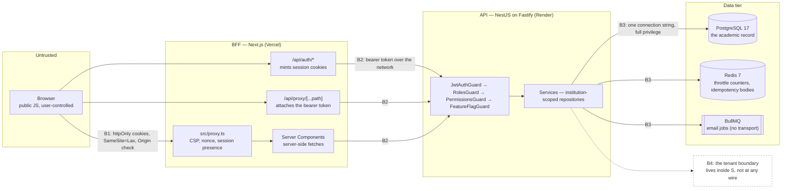

# Threat Model

STRIDE against StudViro as it stands at 2026-09-19, per trust boundary. Written against the
code: every mitigation named below cites the file that implements it, and anything that is
not implemented is listed as not implemented rather than assumed.

Companion to `DPIA.md`, which judges privacy risk, and `GDPR Data Inventory.md`, which
enumerates the fields. This document asks a narrower question: who can cross which boundary,
and what stops them.

StudViro is **the system of record** for an institution's own academic data (ADR 0024).
There is no upstream and no second copy. A forged grade is not a stale mirror of a correct
one held elsewhere; it is the record. That single fact sets the severity of most of what
follows.

## What the institution must supply

Everything below depends on the deployment environment, the hosting provider's controls or
institutional policy. None of it can be answered from the code, and nothing in this document
assumes an answer. Each item is also marked `TODO(institution)` at the point where it
matters.

| Unknown                                   | What is needed                                                                                        | What it blocks here                                                                                                                                           |
| ----------------------------------------- | ----------------------------------------------------------------------------------------------------- | ------------------------------------------------------------------------------------------------------------------------------------------------------------- |
| **Hosting provider and controls**         | Who runs PostgreSQL, Redis and the two application halves; what network isolation exists between them | Boundary B3 assumes the database is not reachable from the public internet. The code cannot enforce that                                                      |
| **TLS termination and `TRUSTED_PROXIES`** | The exact proxy hops in front of the API, by address or CIDR                                          | `TRUSTED_PROXIES` defaults to `loopback` (`src/config/env.schema.ts:37`). A wrong value either breaks rate limiting or lets a client forge its source address |
| **Mail transport**                        | An SMTP or API provider, its credentials, and the sender domain with SPF/DKIM/DMARC                   | There is no mail transport. Invitation and password-reset tokens cannot reach anyone in production                                                            |
| **Backup and restore policy**             | Where backups live, how they are encrypted, how often restore is tested                               | Threat D3 (destructive tenant-wide write) has no recovery story without one                                                                                   |
| **Log retention and access**              | Who can read Pino output, for how long, and from where                                                | Logs carry user ids, IP addresses and request paths. Boundary B3's information-disclosure rating depends on who reads them                                    |
| **Encryption at rest**                    | Whether the provider encrypts the database volume, and who holds the key                              | The application encrypts nothing at rest itself                                                                                                               |
| **Incident response and disclosure**      | Who is paged, on what signal, and the Art. 33 notification path                                       | The code emits the signals (§ Boundary B2, `AllExceptionsFilter`); nobody is listening                                                                        |
| **Penetration test and review**           | Whether an independent test is required before go-live, and by whom                                   | This document is a paper exercise; nothing here has been tested against a running deployment                                                                  |
| **Account lifecycle policy**              | What happens to a leaver's account, and who may reset another person's password                       | There is no administrative password reset, so the answer today is "nothing" or "out of band"                                                                  |

## Trust boundaries

Four boundaries, and the fourth is the dangerous one:

- **B1 — browser to BFF.** The only boundary an attacker reaches without credentials.
- **B2 — BFF to API.** Two hosted halves on different providers, talking over the internet.
- **B3 — API to the data tier.** One connection string, one database role, full privilege.
- **B4 — between institutions.** No wire, no process, no database boundary. It is a `where`
  clause applied by each service. Everything in § Multi-tenant isolation is about this.

## Assets, ranked

| #   | Asset                                                                                                                                         | Why it ranks here                                                                                                                                                                                         |
| --- | --------------------------------------------------------------------------------------------------------------------------------------------- | --------------------------------------------------------------------------------------------------------------------------------------------------------------------------------------------------------- |
| A1  | **Official course results** — `official_course_results.official_grade`                                                                        | The product's reason to exist, and the one record with legal effect on a person's progression. There is no upstream to reconcile against (ADR 0024), so a forged or silently altered grade is simply true |
| A2  | **Exam registrations and seats** — `exam_registrations`                                                                                       | Denying someone a seat, or taking one, changes what they can sit this term. Time-bound and unrecoverable after the window closes                                                                          |
| A3  | **Enrolments and programme memberships**                                                                                                      | They _are_ the authorization graph: `student` and `teacher` are derived from them (`derived-roles.repository.ts`), so writing one grants a role. Not merely data                                          |
| A4  | **Role assignments** — `role_assignments`                                                                                                     | `institution_admin` holds every permission (`permissions.ts`). One row is the whole institution                                                                                                           |
| A5  | **Authentication material** — `users.password_hash`, `refresh_tokens.token_hash`, `password_reset_tokens.token_hash`, and the two JWT secrets | Compromise of a JWT secret forges any principal in any institution without touching the database                                                                                                          |
| A6  | **Identity and contact data** — `users`, `user_emails`, `invitations`                                                                         | Ordinary personal data, enumerable into a roll of who studies what. Catalogued in `GDPR Data Inventory.md`                                                                                                |
| A7  | **Availability of the platform during assessment periods**                                                                                    | An outage on the day registration closes is a real harm even with no data loss                                                                                                                            |
| A8  | **Marketing leads** — `demo_requests`                                                                                                         | Personal data, but volunteered, and its loss harms nobody academically                                                                                                                                    |

## Boundary B1 — browser to BFF

The BFF is the only origin the browser talks to. `NEXT_PUBLIC_API_URL` exists, but the API
is never called from page JavaScript (`docs/Deployment.md`; `csp.ts` keeps `connect-src 'self'`).

### Spoofing

**Threat.** Signing in as somebody else: credential guessing, stolen session cookie,
session fixation.

**Mitigated.** Argon2id at the OWASP baseline with in-place upgrade on sign-in
(`src/common/crypto/password.service.ts`, `auth.service.ts:login`). Account enumeration is
closed on both endpoints that could leak it — `login` verifies against `ABSENT_USER_DIGEST`
so a missing account costs the same as a real one (`auth.service.ts`), and
`PasswordResetService.request` returns success either way. Tokens are re-housed as httpOnly,
`SameSite=Lax`, first-party cookies (`frontend/src/shared/config/session.ts`); page JS cannot
read them. The refresh cookie is path-scoped to `/api/auth`
(`REFRESH_COOKIE_PATH`), so an injected script that can force requests is still limited to
the access token's lifetime. Credential routes get their own small budget
(`app.module.ts`, `CREDENTIAL_THROTTLER`).

**Residual.** The credential budget is keyed on the source address, and every request
arrives from the BFF's address — the code says so itself in
`src/common/throttling/public-form-throttle.decorator.ts`. So on the credential throttler
the deployment has one shared budget: an attacker consumes it for everyone (a lockout of
sign-in), and an attacker on rotating serverless egress addresses gets a larger one than
intended. There is no per-account lockout, no CAPTCHA, no second factor, and no
notification on sign-in from a new device. `TODO(institution)` — whether policy requires MFA.

### Tampering

**Threat.** Cross-site request forgery; script injection changing what the user submits.

**Mitigated.** `SameSite=Lax` withholds the cookies from a cross-site POST, and every
`/api/auth/*` handler and every non-GET through `/api/proxy` additionally rejects a
mismatched `Origin` (`frontend/src/shared/auth/auth-route.ts:isSameOrigin`, used in
`app/api/proxy/[...path]/route.ts`). A nonce-based CSP is minted per request
(`proxy.ts:createNonce`, `shared/config/csp.ts`) with `object-src 'none'`,
`base-uri 'self'`, `form-action 'self'` and `frame-ancestors 'none'`; the proxy `set`s
rather than appends `x-nonce` precisely so a client cannot supply the value the policy
trusts. Path traversal through the catch-all proxy is rejected segment by segment
(`isTraversalFree`), and the open-redirect sink on `?next=` is constrained to a same-site
absolute path (`safeNext`).

**Residual.** There is no CSRF token; the defence is `SameSite` plus `Origin`, which is
adequate but leaves nothing if a future cookie is added with looser flags. `style-src`
keeps `'unsafe-inline'` — a considered trade documented in `csp.ts`, and a genuine residual
for style-based exfiltration. `PROTECTED_PREFIXES` in `proxy.ts` is a hand-maintained list;
a new authenticated route left off it renders its shell to a signed-out visitor. That is a
correctness bug rather than a disclosure — the data fetch still fails at B2 — but it is a
list that will be forgotten.

### Repudiation

**Threat.** A user denies having submitted something.

**Not mitigated at this boundary.** The BFF logs nothing of its own. See Boundary B2.

### Information disclosure

**Threat.** Reading another user's data out of the browser, or out of a shared machine.

**Mitigated.** Nothing sensitive is in `localStorage` — the only thing there is the theme
(`csp.ts:THEME_INIT_SCRIPT`). The API's own origin is unreachable from the page, so an
injected script has no allowed destination (`connect-src 'self'`).

**Residual.** `sv_at` is a JWT carrying the user's email and role in its payload
(`auth.constants.ts:AccessTokenPayload`); it is httpOnly, so this only matters to someone
with the cookie jar. The locale cookie is deliberately readable by JS and carries no
authority.

### Denial of service

**Threat.** Flooding the public surface.

**Mitigated in part.** A separate, larger budget for unauthenticated forms
(`PUBLIC_FORM_THROTTLER`), sized on the explicit reasoning that they all arrive from one
address. Body size is capped (`BODY_LIMIT_BYTES`) and requests time out
(`TimeoutInterceptor`).

**Residual.** Vercel's and Render's own edge protections are the real answer here and are
outside the code. `TODO(institution)` — provider DDoS and WAF controls.

### Elevation of privilege

**Threat.** A signed-out visitor reaching a signed-in screen.

**Mitigated.** `proxy.ts` only does a cookie _presence_ test and says so; the authorization
that matters happens in the layouts and Route Handlers that own the data, and ultimately at
B2. A forged cookie buys a rendered shell and 401s.

## Boundary B2 — BFF to API

Two providers, one network hop, a bearer token.

### Spoofing

**Threat.** Calling the API directly with a token of one's own choosing, or replaying an
access token as a refresh token.

**Mitigated.** `JwtAuthGuard` is a global `APP_GUARD` (`auth.module.ts`), so a route is
unreachable unless it opts out with `@Public()` — deny by default, and the four public
routes are countable (`auth.controller.ts`, `password-reset.controller.ts`,
`invitations.controller.ts:accept`, `demo-requests.controller.ts`, plus `health`). Access
and refresh tokens are signed with **different** secrets, and `env.schema.ts` refuses to
boot production if they match or if either is the development default. A valid signature is
not sufficient: `JwtStrategy.validate` re-reads `users.token_version` and `users.status` on
every request, so sign-out-everywhere, a password change and a suspension take effect
immediately. The proxy strips a caller-supplied `authorization` and `cookie` before
forwarding (`STRIPPED_REQUEST_HEADERS`) and strips `set-cookie` on the way back, so a
compromised API cannot overwrite the session cookies the BFF owns.

**Residual.** The API is internet-reachable at `https://studviro-backend.onrender.com`
(`docs/Deployment.md`), so the BFF is a convention, not a perimeter — anyone holding a
bearer token can call the API directly and skip every BFF-side control. There is no mTLS,
no shared secret between the halves and no IP allow-list. `TODO(institution)` — whether the
API origin can be restricted to the BFF's egress.

### Tampering

**Threat.** Forging headers the API trusts.

**Partly mitigated.** `TRUSTED_PROXIES` defaults to `loopback` and production refuses the
value `true` with the reason stated inline: trusting every hop "lets a client forge
X-Forwarded-For and bypass rate limiting" (`env.schema.ts`).

**Not mitigated.** `/api/proxy/[...path]` forwards **every** request header except the six
in `STRIPPED_REQUEST_HEADERS`. `x-forwarded-for` is not among them, and neither is
`x-request-id`, which `bootstrap.ts:genReqId` accepts from the caller as the correlation id.
So a browser can set both. Whether the forged `x-forwarded-for` is believed depends entirely
on how `TRUSTED_PROXIES` is configured — `TODO(institution)`. The forged `x-request-id` is
believed unconditionally and lets a caller collide or poison log correlation.

### Repudiation

**Threat.** Nobody can reconstruct who changed a grade, when, or from where.

**Barely mitigated, and this is the largest gap in the system.** What exists:
`official_course_results.proposed_by_id`, `official_recorded_by_id` and
`official_recorded_at` (`src/database/schema/course-results.ts:97-103`) record the _current_
state's author; `timestamps` gives every table `created_at` and `updated_at`
(`schema/_shared.ts`); 401, 403 and 429 are logged at `warn` deliberately because "a burst
of them is the signal an incident starts from" (`all-exceptions.filter.ts`); refresh tokens
carry `ip_address` and `user_agent` (`auth.controller.ts:sessionContextOf`).

What does not exist: **there is no audit event table and no audit event anywhere.** `grep`
for `audit` across `src/` returns three comments about timestamp columns and nothing else.
A grade corrected twice keeps only the second author; the first value, the first author and
the time of the change are gone. Role grants, enrolment corrections, exam-term cancellations
and institution-configuration changes leave no record at all beyond the row's final state.
And because refresh tokens record the _BFF's_ address rather than the user's, the one
place an address is stored is of no forensic use.

### Information disclosure

**Threat.** Error responses or logs leaking internals.

**Mitigated.** `AllExceptionsFilter` maps driver errors to a fixed catalogue and collapses
anything unrecognised to a bare `INTERNAL_ERROR` with no stack and no driver text. Pino
redacts `authorization`, `cookie`, `set-cookie`, `x-api-key`, `proxy-authorization`,
`req.body.password`, `req.body.token` and `req.body.refreshToken`
(`src/common/logger/logger.module.ts`). Swagger is off by default and, in production,
refuses to be enabled without Basic credentials — compared with `timingSafeEqual`
(`bootstrap.ts:sameValue`). `/metrics` requires a bearer token in production
(`env.schema.ts`, `src/metrics/metrics.guard.ts`).

**Residual.** The redaction list is by path, so any new secret-bearing body field must be
added by hand. Two secrets travel in URL path segments and are therefore in every access
log, proxy log and `Referer`: the invitation token at `POST /invitations/:token/accept`
(`invitations.controller.ts:54`) and, in the error body, the `path` field that
`AllExceptionsFilter` echoes back. The tokens are single-use and hashed at rest
(`schema/invitations.ts`), which limits but does not remove this.

### Denial of service

**Threat.** Exhausting the API.

**Mitigated.** Three throttlers over shared Redis storage, namespaced by `QUEUE_PREFIX` so
two environments cannot share counters (`app.module.ts`); per-request timeout; body limit;
graceful shutdown with a drain window (`SHUTDOWN_DRAIN_MS`); readiness that proves the
schema and not merely the socket, so an unmigrated database is held out of rotation rather
than serving 500s (`docs/Deployment.md`, `/health/ready`).

**Residual.** Because every request shares the BFF's source address, all three budgets are
effectively deployment-wide rather than per-caller. One authenticated user hammering a
listing endpoint spends the default budget for everybody.

### Elevation of privilege

**Threat.** Reaching a route without the permission it requires.

**Mitigated.** `PermissionsGuard` is a global `APP_GUARD` (`authorization.module.ts`) and
resolves the scope named in the route's `@RequirePermission`, walking the org-unit ancestry
with a recursive CTE (`scope-hierarchy.service.ts`) so a role held at a faculty covers the
programmes under it. `ValidationPipe` runs with `whitelist` and `forbidNonWhitelisted`, so
an unexpected body field is a 400 rather than a silent mass-assignment
(`bootstrap.ts`). Derived roles are not grantable: `GRANTABLE_ROLES` excludes
`student`, `teacher` and `teaching_assistant` (`authorization.constants.ts`) and
`GrantRoleDto` validates against that list, so nobody can hand out `teacher` and inherit
`grade:publish` over an institution. A granter may only grant a role whose every permission
they already hold, checked at the scope being granted on
(`role-assignments.service.ts:assertMayGrant`), and an institution's last admin cannot be
revoked.

**Residual — the guard is coarser than the decision.** Almost every
`@RequirePermission` in the codebase names `{ type: 'institution', param: 'institutionId' }`,
including grade entry (`offering-results.controller.ts`). So the guard proves only "this
caller holds `grade:propose` _somewhere_ in this institution". The real check — do you
actually teach this offering — lives in the service
(`offering-results.service.ts:viewerRole`, `course-roster.service.ts`). That is a
deliberate design, but it means **the guard is not the authorization decision**, and a new
route that carries the decorator and forgets the service-side check is wide open by
default rather than closed. `PermissionsGuard` denies when the route declares no
requirement? No — `if (!required) return true`. An authenticated caller reaches any route
with no `@RequirePermission` on it.

**Residual — the platform-operator tier.** `@Roles('admin')` on `UsersController` is the
`users.role = 'admin'` tier, which is global, not per-institution. It lists, reads and
soft-deletes **every account in every institution** (`users.controller.ts`). ADR 0016's
premise is that this tier holds no academic permission, which is true of the permission
catalogue — and false of the user directory.

## Boundary B3 — API to PostgreSQL, Redis and the queue

### Spoofing and tampering

**Mitigated.** Every query goes through Drizzle with bound parameters; the one place raw
SQL is written is the ancestry CTE in `scope-hierarchy.service.ts`, and the id is
interpolated as a parameter. Sort keys never reach SQL as text — `BaseRepository.sortable`
is an allow-list keyed by the name the client passes, and anything outside it is rejected.
Writes that two requests could race are expressed as `upsert` with `ON CONFLICT` rather than
check-then-insert, and refresh rotation takes `SELECT … FOR UPDATE`
(`refresh-tokens.repository.ts:findByHashForUpdate`).

**Residual.** The application connects with one role that owns everything. There is no
read-only role for the replica path, no per-tenant role, and **row-level security is off on
every table** — every Drizzle snapshot in `drizzle/meta/` carries `"isRLSEnabled": false`.
Anything reaching the connection string reaches all institutions at once.
`TODO(institution)` — network isolation between the API and the data tier, and where the
connection string is stored.

### Repudiation

**Not mitigated.** PostgreSQL statement logging, if any, is a provider setting.
`TODO(institution)`.

### Information disclosure

**Mitigated in part.** `DATABASE_SSL` and `REDIS_TLS` exist and both default to `false`
(`env.schema.ts:44,52`) — correct for a laptop, and _not_ asserted in the production
hardening block, unlike `CORS_ORIGINS`, `TRUSTED_PROXIES` and the JWT secrets. A production
deployment that forgets them talks to its database in the clear and nothing complains.

**Residual.** The application encrypts nothing at rest. Redis holds complete response bodies
for idempotent writes (`idempotency.interceptor.ts` stores `body` under a key namespaced by
principal), so personal data lives outside PostgreSQL for the key's lifetime.
`TODO(institution)` — volume encryption and key custody.

### Denial of service

**Mitigated.** Statement timeouts and connection exhaustion are mapped to `57014` and
`53300` and answered as 504 and 503 rather than as 500s
(`all-exceptions.filter.ts:PG_CODE_MAP`). Multi-batch inserts are chunked under Postgres'
bind-parameter ceiling (`base.repository.ts`).

### Elevation of privilege

**Residual.** Migrations run as the same owning role
(`pnpm db:migrate:prod`, `docs/Deployment.md`). There is no separation between the migrating
identity and the serving identity.

## Boundary B4 — between institutions

Treated on its own below, because it is not a boundary anything enforces for you.

## Multi-tenant isolation

### How a cross-institution read is prevented today

Three things in series, and only the first two are structural.

**1. The route names the institution.** Nearly every controller is mounted under
`institutions/:institutionId/…` (`course-offering.controller.ts`, `my-courses.controller.ts`,
`rooms.controller.ts`, and the rest). The tenant is a URL segment, validated as a UUID by
`ParseUUIDPipe`.

**2. `PermissionsGuard` proves standing in _that_ institution.** It reads `institutionId`
from `request.params`, and `AuthorizationService.rolesIn` resolves the scope
(`scope-hierarchy.service.ts`) and then intersects the caller's role assignments and derived
roles against the resolved scope keys. Both sources are themselves fetched by
`institutionId`: `RoleAssignmentsRepository.findActiveForUser(resolved.institutionId, …)`
and `DerivedRolesRepository.findFor(institutionId, userId)`, whose queries filter on
`program_memberships.institution_id` and `teaching_assignments.institution_id`. A user with
no role in institution B gets an empty role list for B and a 403 — regardless of what they
hold in A. This is the load-bearing control.

**3. The service scopes the query.** `InstitutionScopedRepository.withinInstitution` ANDs
`institution_id = $1` onto every read it offers — `findByIdIn`, `findOneIn`, `findManyIn`,
`existsIn`, `countIn`
(`src/database/repository/institution-scoped.repository.ts`). Services pass the
`institutionId` from the URL, which step 2 has just proved the caller belongs to. Where a
nested id could come from elsewhere, the lookup is scoped: `RoomsService.update` starts
with `this.rooms.findByIdIn(institutionId, id)` and 404s otherwise
(`src/modules/institutions/rooms.service.ts`); `OfferingResultsService.offeringOrFail` takes
`institutionId` and `offeringId` together. `RoleAssignmentsService.grant` goes further and
re-resolves the requested scope, rejecting it with `SCOPE_OUTSIDE_INSTITUTION` if the
resolved institution differs from the URL's — the one place in the codebase that explicitly
defends against a cross-tenant confused deputy.

### Where the guarantee can be bypassed

**Nothing enforces step 3.** There is no RLS, no session variable, no query-level
interceptor and no test that a route is scoped. The isolation invariant is a convention that
each service re-implements per call.

Five concrete ways a route forgets:

1. **A nested id from another institution.** Step 2 only proves standing in the institution
   in the _URL_. If a service takes `:offeringId`, `:enrollmentId` or `:programId` and looks
   it up with the unscoped `BaseRepository.findById` instead of `findByIdIn`, a user with any
   role in A reads B's row by pasting B's UUID into A's URL. Today the audited services do
   scope — `findByIdIn` / `findByIdInOrFail` appears twelve times, and the unscoped
   `findByIdOrFail` calls are all on `users` and `institutions`, which are not
   institution-scoped tables. Nothing prevents the thirteenth from being wrong.

2. **Writes are unscoped by construction.** `InstitutionScopedRepository` offers scoped
   _reads_ only. There is no `updateIn` and no `softDeleteIn`; `grep` finds neither. Every
   write goes through `BaseRepository.update(id, …)` / `softDelete(id)`, whose `where` is
   `id = $1 AND deleted_at IS NULL` and nothing more. `RoomsService.update` is safe only
   because of the `findByIdIn` two lines above it. Drop that line and the method
   cross-writes. This is the single highest-leverage fix in the document: adding `updateIn`
   and `softDeleteIn` and forbidding the unscoped pair on scoped repositories would convert
   a convention into an invariant.

3. **A route with no `@RequirePermission`.** `PermissionsGuard.canActivate` returns `true`
   when no requirement is declared. `JwtAuthGuard` still runs, so the route is not public —
   but it is open to _every authenticated user in every institution_. The decorator is what
   makes a route tenant-aware, and forgetting it fails open. Contrast `JwtAuthGuard`, which
   fails closed and says so in its own comment.

4. **`users` is a global table.** Identity is deliberately cross-tenant: one person, one
   row, many institutions. `UsersRepository.findInvitedByEmail` is not scoped at all
   (`users.repository.ts:55`), so two institutions inviting the same address contend for one
   shadow row — already recorded in `STATUS.md` and ADR 0018.
   `RoleAssignmentsService.grant` likewise checks `users.existsById(dto.userId)` globally, so
   an admin of A may grant a role in A to a user who has only ever belonged to B. That is
   probably intended behaviour, but it makes a global user id an accepted input on a
   tenant-scoped route.

5. **The `admin` tier sits above the boundary entirely.** `UsersController` is cross-tenant
   by design (§ B2). Nothing about it is a bug; it is simply a class of principal for whom
   B4 does not exist, and its existence should be a deliberate operational decision.
   `TODO(institution)` — who holds `users.role = 'admin'`, and under what controls.

## Threats not mitigated today

Ranked by severity: what it costs if exploited, times how reachable it is.

| #   | Threat                                                                                                                                                                                                                                                                                                                                                    | STRIDE  | Boundary | Severity                          | What would fix it                                                                                                                                                                                                                                                                                                                       |
| --- | --------------------------------------------------------------------------------------------------------------------------------------------------------------------------------------------------------------------------------------------------------------------------------------------------------------------------------------------------------- | ------- | -------- | --------------------------------- | --------------------------------------------------------------------------------------------------------------------------------------------------------------------------------------------------------------------------------------------------------------------------------------------------------------------------------------- |
| U1  | **No structured audit events.** A grade correction, a role grant, an enrolment override or a term cancellation leaves only the row's final state. No actor, no before-value, no time, for anything but the current grade author                                                                                                                           | R, T    | B2, B4   | **High**                          | An append-only `audit_events` table (`institution_id`, actor, action, subject, before/after, request id, timestamp) written in the same transaction as the change, emitted from the services that already know the verb — grades, role assignments, enrolment corrections, exam terms, institution configuration                        |
| U2  | **Tenant isolation on writes is a convention, not an invariant.** `InstitutionScopedRepository` has no scoped write; RLS is off on every table; `PermissionsGuard` returns `true` for an undecorated route                                                                                                                                                | E, T, I | B4       | **High**                          | Add `updateIn` / `softDeleteIn` / `updateManyIn` and lint or type the unscoped pair out of reach on scoped repositories. Add an e2e test per scoped route that a second institution's id 404s. Make `PermissionsGuard` deny by default and require an explicit opt-out decorator, matching `JwtAuthGuard`                               |
| U3  | **No mail transport, so account recovery and onboarding do not work in production.** `EmailProcessor` logs and resolves (`queue/processors/email.processor.ts:36,49` — `TODO: swap for the real mail transport`); `PasswordResetService.request` does not even enqueue a job; both it and `InvitationsService` withhold the raw token when `isProduction` | D, S    | B1, B2   | **High**                          | Wire the transport and enqueue from `PasswordResetService.request`. Until then the only recovery path is out-of-band token handling, which trains institutions to pass raw single-use credentials over chat — and there is no administrative reset either. `TODO(institution)` — provider and sender domain                             |
| U4  | **No personal-data export and no erasure.** Nothing in `src/modules` implements Art. 15 or Art. 17; `softDelete` sets `deleted_at` and keeps every field, including `password_hash`, `email`, IP addresses and grades                                                                                                                                     | I, R    | B3       | **High**                          | A per-subject export assembling the categories in `GDPR Data Inventory.md`, and an erasure verb that distinguishes what must be retained (the academic record, under a retention period) from what must go (contact data, session history, notification bodies). `TODO(institution)` — retention period and lawful basis, per `DPIA.md` |
| U5  | **Rate limiting is effectively deployment-wide.** Every request reaches the API from the BFF's address; the code acknowledges this in `public-form-throttle.decorator.ts`. One caller can spend the credential budget for every user                                                                                                                      | D, S    | B1, B2   | Medium                            | Key the credential throttler on the submitted email and the authenticated throttler on `user.id` rather than on the address. Add a per-account backoff. Neither depends on knowing the proxy topology                                                                                                                                   |
| U6  | **Client headers pass through the BFF unfiltered.** `x-forwarded-for` and `x-request-id` are not in `STRIPPED_REQUEST_HEADERS`; the first can defeat rate limiting depending on `TRUSTED_PROXIES`, the second poisons log correlation                                                                                                                     | T, R    | B2       | Medium                            | Strip both in `app/api/proxy/[...path]/route.ts` and have the BFF set them itself. `TODO(institution)` — the correct `TRUSTED_PROXIES` value                                                                                                                                                                                            |
| U7  | **`DATABASE_SSL` and `REDIS_TLS` default to `false` and are not asserted in production.** `assertProductionHardening` checks CORS, proxies, secrets, Swagger and metrics, and not these two                                                                                                                                                               | I       | B3       | Medium                            | Two more clauses in `assertProductionHardening` (`src/config/env.schema.ts`), the same shape as the existing five                                                                                                                                                                                                                       |
| U8  | **The platform `admin` tier reads every account in every institution** (`users.controller.ts`, `@Roles('admin')`), which ADR 0016's "no academic permission" framing does not cover                                                                                                                                                                       | I, E    | B4       | Medium                            | Either scope the listing to institutions the operator administers, or accept it explicitly and log every access under U1. `TODO(institution)` — who holds this role                                                                                                                                                                     |
| U9  | **A rotated refresh token can fail to persist and self-revoke every session.** `frontend/src/shared/auth/session.ts:persist` swallows the write failure during an ordinary render; the API has already revoked the old token, so the next presentation trips reuse detection and `AuthService.refresh` revokes all sessions and bumps `token_version`     | D       | B1       | Medium                            | Rotate only from a Route Handler or Server Action where the cookie store is writable, or give the API a short grace window in which the immediately-preceding token is accepted rather than treated as a leak                                                                                                                           |
| U10 | **No grade history.** `official_course_results` keeps `proposed_by_id` and `official_recorded_by_id` for the current value only; a correction overwrites the previous grade and its author                                                                                                                                                                | R, T    | B4       | Medium                            | A result-revision table, or U1's audit events carrying the before-value. A dispute over a changed grade is unanswerable today                                                                                                                                                                                                           |
| U11 | **Invitation tokens travel in the URL path** (`POST /invitations/:token/accept`) and therefore into access logs, proxy logs and the `path` field of every error body                                                                                                                                                                                      | I       | B2       | Low                               | Move the token into the request body. It is already hashed at rest and single-use, which caps the damage                                                                                                                                                                                                                                |
| U12 | **No alerting on the signals the code already emits.** `AllExceptionsFilter` logs 401/403/429 at `warn` and `AuthService.refresh` logs `refresh token reuse detected` — a near-certain indicator of a stolen token — and nothing consumes either                                                                                                          | R, D    | B2       | Low (code) / High (operationally) | `TODO(institution)` — a log sink and an alert on reuse detection and on 401/403 bursts. The instrumentation exists; the destination does not                                                                                                                                                                                            |
| U13 | **Nothing is encrypted at rest by the application**, and Redis holds full response bodies for idempotent writes                                                                                                                                                                                                                                           | I       | B3       | Low                               | `TODO(institution)` — provider volume encryption. Shorten the idempotency TTL and store a digest rather than the body where the response carries personal data                                                                                                                                                                          |
| U14 | **No dependency or container scanning gate described for release**, only the repositories' own `pnpm verify` security step                                                                                                                                                                                                                                | T       | B3       | Low                               | `TODO(institution)` — whether a supply-chain gate is required before go-live                                                                                                                                                                                                                                                            |

## What this document does not cover

Physical security, the provider's own personnel controls, the browser's own integrity, and
anything about the release pipeline beyond what `docs/Deployment.md` records. All of it is
`TODO(institution)`.
